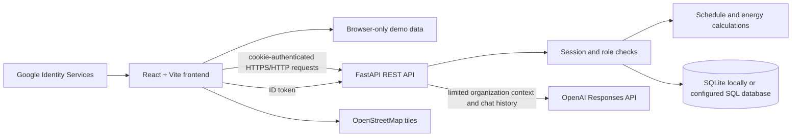
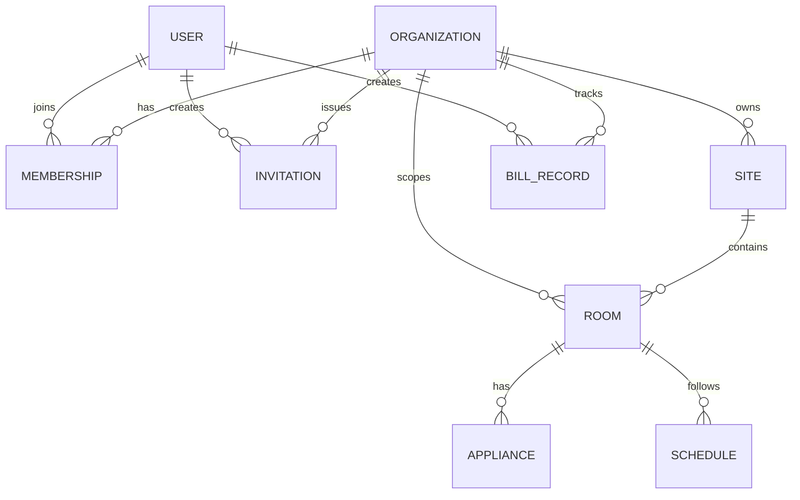

# SyncSpace — Complete Project Guide

This guide describes the current SyncSpace repository: what the application is for, how its parts fit together, how to run it, what data it stores, and what is required to operate it beyond the assignment demo. It is written against the code in this repository; details may change as the project evolves.

## Contents

1. [Project at a glance](#1-project-at-a-glance)
2. [What the application does](#2-what-the-application-does)
3. [Repository map](#3-repository-map)
4. [Architecture and request flow](#4-architecture-and-request-flow)
5. [Roles and access](#5-roles-and-access)
6. [Data model](#6-data-model)
7. [Energy model and calculations](#7-energy-model-and-calculations)
8. [Feature walkthrough](#8-feature-walkthrough)
9. [API reference](#9-api-reference)
10. [Validation and operational limits](#10-validation-and-operational-limits)
11. [Authentication and security](#11-authentication-and-security)
12. [AI energy advisor](#12-ai-energy-advisor)
13. [External services and integrations](#13-external-services-and-integrations)
14. [Run the project locally](#14-run-the-project-locally)
15. [Configuration reference](#15-configuration-reference)
16. [Database behavior and maintenance](#16-database-behavior-and-maintenance)
17. [Build and deployment](#17-build-and-deployment)
18. [Troubleshooting](#18-troubleshooting)
19. [Current limitations and future work](#19-current-limitations-and-future-work)
20. [Glossary](#20-glossary)

## 1. Project at a glance

**SyncSpace** is a web workspace for organizing building locations, facility zones, equipment ratings, operating schedules, electricity-bill records, and team access. It turns entered equipment and schedule data into planning estimates that help a team decide what to inspect first.

The repository supports two ways to use the frontend:

- **Assignment demo:** a sample campus runs in the browser without an account or API server. Its sample facilities and bill records are illustrative. Changes are temporary and are lost when the browser session is reset or closed.
- **Live organization workspace:** users sign in to a FastAPI service. Organization, team, site, zone, schedule, and bill data are saved to the configured database and scoped to the signed-in organization.

The live workspace can optionally use Google Identity Services for sign-in and the OpenAI Responses API for energy-advisor answers. Those services require deployment configuration. The frontend by itself does not provide persistent account data: GitHub Pages hosts static files, while the API and database must run separately.

### What SyncSpace is and is not

SyncSpace is currently a **schedule-and-equipment planning tool**. It does not read a meter, prove a saving, control a building, fetch bills from an electricity provider, or process a payment. A displayed energy gap is a model estimate and should be checked against meter data, operating conditions, and an on-site review.

## 2. What the application does

The main workspace brings these tasks together:

- Review portfolio-level energy-gap, cost, emissions, and schedule-coverage estimates.
- Rank a small number of zones for attention based on their modeled schedule gap.
- View expected hourly equipment demand calculated from schedules; this chart is not a meter trace.
- Create organization locations and place them on an OpenStreetMap-backed map.
- Set a location pin by clicking a map or pasting a full Google Maps URL with readable coordinates.
- Group zones into blocks and locations, move a zone between locations, and inspect its equipment and timetable.
- Upload a building plan as PNG, JPG, WEBP, or PDF.
- Add schedules individually or import them from CSV.
- Keep an electricity-bill ledger, mark records paid with an external reference, export records, and open an externally hosted provider payment page if one is configured.
- Invite a team and assign owner, admin, manager, or staff roles.
- Ask the optional AI energy advisor about the current organization's schedule-based model and request practical plans or suggestions.

New organizations start with **no sample locations, zones, schedules, or fabricated energy figures**. The organization has default model settings (₹8/kWh tariff, 0.82 kg CO₂e/kWh carbon factor, and 8 operating hours/day) until an owner or admin updates them. Users add their own facility data before the workspace can produce meaningful estimates.

## 3. Repository map

```text
.
├── README.md                       Quick start and deployment notes
├── PROJECT_REPORT.md               ESD assignment report and presentation flow
├── PROJECT_GUIDE.md                This technical and product handbook
├── .github/workflows/
│   └── deploy-pages.yml            Frontend build and GitHub Pages deployment
├── backend/
│   ├── main.py                     FastAPI app, middleware, router registration
│   ├── database.py                 SQLAlchemy engine and startup schema adjustments
│   ├── models.py                   SQLAlchemy database models
│   ├── schemas.py                  Pydantic request and response validation
│   ├── crud.py                     Organization-scoped facility data operations
│   ├── services.py                 Schedule merge and energy calculations
│   ├── auth_security.py            Password hashes, signed sessions, role checks
│   ├── routers/
│   │   ├── auth.py                 Signup, login, team, organization settings
│   │   ├── sync.py                 Sites, zones, schedules, bills, analysis
│   │   └── advisor.py              Optional AI advisor endpoint
│   ├── requirements.txt            Pinned Python dependencies
│   ├── .env.example                Server configuration template
│   └── timetable.csv               Example schedule data
└── frontend/
    ├── index.html                  HTML shell and application metadata
    ├── package.json                Vite scripts and JavaScript dependencies
    ├── vite.config.js              Vite and GitHub Pages base path
    ├── .env.example                Public frontend configuration template
    └── src/
        ├── App.jsx                 Session, demo, and workspace state
        ├── main.jsx                React entry point
        ├── components/             Screens, charts, maps, forms, advisor
        ├── data/                   Provider directory and demo-only records
        ├── services/api.js         HTTP client and API functions
        ├── utils/energyModel.js    Browser-side estimate calculations
        ├── index.css               Base styling and Tailwind import
        └── experience.css          Workspace, account, map, and advisor styles
```

The frontend folder also contains older standalone components such as `PremiumDashboard.jsx` and `Sidebar.jsx`. The current application entry is `App.jsx`; its signed-in product screen is `EnergyWorkspace.jsx`.

## 4. Architecture and request flow



### Frontend flow

`main.jsx` mounts the React application. `App.jsx` checks for an existing session, displays `AuthScreen` when no session is active, and loads dashboard, sites, zones, and (where permitted) bill records after sign-in. Selecting the demo loads sample objects from `data/demoWorkspace.js` instead of calling account APIs. `EnergyWorkspace.jsx` owns the main product interface and its dialogs.

The HTTP client in `services/api.js` sends requests to `VITE_API_BASE_URL` plus `/api/v1`. In local development, it falls back to port 8000. The browser uses an HTTP-only cookie for the live session; it does not store the password or a bearer token in local storage.

### Backend flow

`main.py` creates the FastAPI app, sets CORS origins, rejects mutating browser requests from unapproved origins, initializes the database, and registers the auth, workspace, and advisor routers. Protected handlers resolve the signed session, active membership, and organization with `auth_security.py`. Data queries then use that organization's ID.

The `services.py` energy calculation is also used by workspace summaries. The frontend has a matching calculation helper for immediate display and for the demo. When adding or changing calculations, keep the client and server implementations consistent.

## 5. Roles and access

| Role | Capabilities |
|---|---|
| **Owner** | Manage organization settings and all roles; manage sites, plans, zones, equipment, schedules, bills, invitations, and members. |
| **Admin** | Manage organization settings, facilities, schedules, bills, managers, and staff. Only the owner can promote or manage another admin. |
| **Manager** | Manage locations, building plans, zones, equipment, schedules, room assignments, and bill records. Cannot administer the team or organization settings. |
| **Staff** | Read locations, zones, plans, schedules, and performance information; use the AI advisor when enabled. Cannot modify workspace records or manage bills/team access. |

Role checks are applied by API dependencies, not only by hiding buttons in the browser. Data handlers also filter by organization. The account flow currently expects a user to have one active workspace membership; accepting an invitation to a different already-active workspace is rejected.

Owners and admins can invite `admin`, `manager`, or `staff` roles; an admin cannot invite another admin. Invitations expire after seven days. The token is shown once in the UI and stored in the database as a SHA-256 digest. The person accepting an invitation must use the invited email. An existing account uses its current password; a new password-based account must meet the strong-password rules.

## 6. Data model



| Entity | Purpose and important fields |
|---|---|
| `Organization` | Workspace name, type, state, tariff, carbon factor, operating-hours baseline, preferred BBPS partner name, and optional HTTPS portal URL. |
| `User` | Unique email, full name, scrypt password hash, optional unique Google subject, and active/disabled flag. |
| `Membership` | Connects a user and organization with a role and active flag. The user/organization pair is unique. |
| `Invitation` | Organization, target email, role, hashed token, creator, expiry, and accepted timestamp. |
| `Site` | Organization-owned location with address/city/state, optional latitude/longitude, and optional schematic metadata and binary file. |
| `Room` | A facility zone with organization ID, optional site ID, name, and block. The UI often calls these zones; the API/model calls them rooms. |
| `Appliance` | Equipment name and rated power in watts, attached to a room. |
| `Schedule` | Day label and start/end times, attached to a room. |
| `BillRecord` | Organization-owned biller, state, site label, reference, amount, due date, status, paid date/reference, and creator. |

There is no dedicated device telemetry, meter-reading, action-history, or payment-transaction model yet. The optional site schematic is stored in the database as a binary column and is deferred from ordinary site queries.

## 7. Energy model and calculations

### Inputs

- Equipment rated power in watts.
- A zone's weekly operating timetable.
- The organization's operating-hours baseline in hours/day.
- The organization's tariff in rupees per kWh.
- The organization's emissions factor in kg CO₂e per kWh.

### Equations

1. **Connected load (kW)** = sum of equipment ratings (W) ÷ 1,000.
2. **Scheduled hours/day** = total non-overlapping scheduled minutes for the week ÷ 60 ÷ 7.
3. **Idle hours/day** = max(0, operating-hours baseline − scheduled hours/day).
4. **Modeled energy gap (kWh/day)** = connected load (kW) × idle hours/day.
5. **Modeled cost (₹/day)** = modeled energy gap × tariff (₹/kWh).
6. **Emissions associated with the modeled gap (kg CO₂e/day)** = modeled energy gap × emissions factor (kg CO₂e/kWh).
7. **Schedule coverage (%)** = scheduled hours/day ÷ operating-hours baseline × 100, capped at 100% for display/aggregation.

Overlapping timetable entries are merged before calculating scheduled time. The full weekday names (Monday through Sunday) are recognized, as are `Everyday`, `Daily`, and `All days` (case-insensitive). An end time earlier than a start time represents an overnight interval. Equal start and end times contribute no duration. A schedule longer than the configured baseline produces zero idle hours; the percentage score is capped at 100.

### Worked example

Suppose a zone has 4,500 W of rated equipment (4.5 kW), six average scheduled hours/day, and an eight-hour baseline. With the default ₹8/kWh tariff and 0.82 kg CO₂e/kWh factor:

- Idle hours/day = 8 − 6 = 2.
- Modeled gap = 4.5 × 2 = **9 kWh/day**.
- Modeled cost = 9 × 8 = **₹72/day**.
- Associated emissions = 9 × 0.82 = **7.38 kg CO₂e/day**.

### Interpretation

The model assumes connected equipment could draw its full rated load during hours outside the submitted timetable. Actual loads may be lower because equipment cycles, modulates, is switched off, or operates differently from the entered schedule. A result is a **planning estimate**, not verified waste, actual consumption, an emissions inventory, or guaranteed savings. Validate with interval meter data, occupancy, operating procedures, and a site inspection before acting or reporting a saving.

The hourly schedule profile is also a model: it spreads rated load over the entered timetable. It is not a live electrical demand curve.

## 8. Feature walkthrough

### 8.1 Signup and sign-in

Users can create a workspace with an email/password account or Google signup, then sign in with email/password or Google. Password signup asks for a new password twice and displays a live strength meter. Owners/admins can create invitation links for teammates.

### 8.2 Portfolio overview and action center

The overview summarizes the zones currently loaded for the organization. The action center ranks the first three zones with a positive modeled gap, from largest to smallest, and opens zone detail for review. Empty organizations show empty-state guidance instead of sample values.

### 8.3 Locations and map pins

Locations are organization-owned. A pin is optional. The location form offers a click-on-map picker or a full Google Maps link with coordinates. The map picker uses OpenStreetMap tiles and defaults to an India-wide view. A shortened Google Maps sharing URL generally does not contain coordinates the browser can parse; open it in Google Maps and copy the full address-bar URL, or mark the spot on the map.

The portfolio map displays mapped sites and groups zones by building/block. A zone can be assigned to a different site. Map pins and addresses are visible to members of the owning organization.

### 8.4 Zones, equipment, and timetables

Create a zone with a name, block, optional site selection (the UI selects a site), and equipment items with rated watts. Then import one or more timetable rows. Once equipment and schedules are saved, the zone and portfolio estimates can be calculated. The zone detail view displays equipment, schedule entries, an estimated daily gap, and a shortcut to import a timetable.

### 8.5 Schedule CSV import

The selected zone is supplied in the UI; it is not a CSV column. The CSV must contain:

```csv
day_of_week,start_time,end_time
Monday,09:00,17:00
Tuesday,09:00,17:00
Wednesday,09:00,17:00
Thursday,09:00,17:00
Friday,09:00,17:00
```

The import accepts UTF-8 (including a UTF-8 BOM), requires the three headers, validates each row, and appends the parsed schedules to the selected zone. A file can be up to 10 MiB. The API reports the first invalid CSV row. Re-importing the same rows is not automatically deduplicated; overlapping intervals are merged by the calculation but the rows remain in the database.

### 8.6 Electricity ledger

Managers, admins, and owners can add bill records, filter by due/paid/archived state, export records, and reconcile a paid bill with an external payment reference. Archived records are marked `void`. Owners/admins can configure a partner label and an HTTPS provider portal URL. Opening that URL leaves SyncSpace for the provider page. SyncSpace does not fetch bill data, call BBPS, move money, or verify a provider's payment.

### 8.7 Team management

Owners and admins can list team members, issue/revoke invitations, change permitted roles, or suspend a membership. Invitation delivery is not automated: the application shows the one-time invitation link for the admin to share. The recipient must open the deployed application origin that matches the organization's deployment.

### 8.8 Ask AI energy advisor

The floating **Ask AI** entry point offers energy, cost, and planning prompts. In a live workspace, the API builds context from the current organization and sends the question plus recent chat history to the AI provider. The demo does not call the AI service. See [AI energy advisor](#12-ai-energy-advisor) for configuration, privacy, and usage limits.

### 8.9 Assignment demo

The sample campus, locations, schedules, bills, and team are defined in `frontend/src/data/demoWorkspace.js`. The demo avoids the API and uses in-memory browser state. Its figures and coordinates are fabricated for demonstration and are separate from live organization records.

## 9. API reference

All product routes are under `/api/v1`; the API client appends this prefix to the configured API root. `GET /` is a basic service health response. The API also serves OpenAPI documentation at `/docs` when running locally.

### Authentication and organizations

| Method and path | Purpose | Access |
|---|---|---|
| `POST /auth/register` | Create an email/password owner and a new empty organization. | Public; duplicate email returns a conflict. |
| `POST /auth/login` | Sign in with email and password. | Public, rate-limited by IP/email. |
| `POST /auth/google/register` | Verify a Google ID token and create an owner workspace. | Public, requires Google client configuration. |
| `POST /auth/google/login` | Verify Google identity and create a session for an existing workspace. | Public, requires Google client configuration. |
| `POST /auth/register-invitation` | Accept a valid invitation and join the organization. | Public with a single-use invitation token. |
| `POST /auth/logout` | Clear the browser's session cookie. | Session. |
| `GET /auth/me` | Return current user, organization, and role. | Any active member. |
| `PATCH /auth/organization` | Update organization settings. | Owner/admin. |
| `GET /auth/members` | List workspace memberships. | Owner/admin. |
| `PATCH /auth/members/{membership_id}` | Change a permitted team role. | Owner/admin, with owner/admin restrictions. |
| `DELETE /auth/members/{membership_id}` | Suspend a membership. | Owner/admin, with owner/admin restrictions. |
| `POST /auth/invitations` | Create a seven-day invitation and return its token once. | Owner/admin. |
| `GET /auth/invitations` | List outstanding invitations. | Owner/admin. |
| `DELETE /auth/invitations/{invitation_id}` | Revoke an invitation. | Owner/admin. |

### Facilities, schedules, and analysis

| Method and path | Purpose | Access |
|---|---|---|
| `GET /sites/` | List the organization's sites. | Any active member. |
| `POST /sites/` | Create a site. | Owner/admin/manager. |
| `PATCH /sites/{site_id}/` | Update a site. | Owner/admin/manager. |
| `POST /sites/{site_id}/schematic/` | Upload a building plan. | Owner/admin/manager. |
| `GET /sites/{site_id}/schematic/` | Read a plan in the organization. | Any active member. |
| `DELETE /sites/{site_id}/schematic/` | Remove a plan. | Owner/admin/manager. |
| `GET /rooms/` | List zones with equipment and schedules. | Any active member. |
| `POST /rooms/` | Create a zone and its initial equipment. | Owner/admin/manager. |
| `PATCH /rooms/{room_id}/site/` | Move a zone to a site. | Owner/admin/manager. |
| `POST /rooms/{room_id}/appliances/` | Add equipment to a zone. | Owner/admin/manager. |
| `POST /rooms/{room_id}/schedules/` | Add a schedule row. | Owner/admin/manager. |
| `POST /rooms/{room_id}/schedules/upload/` | Import schedule rows from CSV. | Owner/admin/manager. |
| `GET /rooms/{room_id}/waste-analysis/` | Calculate one zone's estimates. | Any active member. |
| `GET /campus-dashboard/` | Aggregate zone estimates for the workspace. | Any active member. |

### Electricity ledger and advisor

| Method and path | Purpose | Access |
|---|---|---|
| `GET /bill-records/` | List organization bill records. | Owner/admin/manager. |
| `POST /bill-records/` | Add a bill record. | Owner/admin/manager. |
| `PUT /bill-records/{record_id}/payment` | Mark paid and record the external reference. | Owner/admin/manager. |
| `PATCH /bill-records/{record_id}` | Change bill status, currently used to archive/void. | Owner/admin/manager. |
| `POST /advisor/chat` | Request a workspace-aware advisor answer. | Any active member; requires `OPENAI_API_KEY`. |

The route schemas in `backend/schemas.py` define the authoritative request constraints. Every protected operation should keep organization scoping in its database queries; do not rely on client-provided organization IDs.

## 10. Validation and operational limits

| Data | Current validation / limit |
|---|---|
| Account email | 3–254 characters and checked against an email pattern. |
| New account password | 12–128 characters; requires lowercase, uppercase, ASCII digit, and symbol. Password login accepts the existing stored password as entered. |
| Organization | Name 2–120 characters; type 2–60; state 2–80; tariff 0–1,000; carbon factor 0–3; operating hours greater than 0 and up to 24. |
| Site | Name 2–120; address up to 240; city up to 100; state 2–80; latitude −90 to 90 and longitude −180 to 180. Either both coordinates or neither. |
| Zone | Name and block required, each up to 120; site ID optional at schema level. |
| Equipment | Name 1–120; power greater than 0 and up to 10,000,000 W; up to 50 items on a single zone-creation request. |
| Timetable | Day label 2–24; valid time values. CSV file maximum 10 MiB. |
| Building plan | PNG/JPG/WEBP/PDF, extension and content signature checked, maximum 10 MiB. |
| Bill record | Positive amount up to ₹1,000,000,000; biller/state and due date required. |
| Invitation | Token is hashed in storage, expires in seven days, and must match the invited email. |
| AI question | 1–1,200 characters; up to 10 history items of up to 2,000 characters each; model output capped at 700 tokens. |

## 11. Authentication and security

- Passwords are stored as salted `scrypt` hashes; the raw password is not stored.
- Password-based signup checks the strength requirements in both the browser and API. Password login is not forced to match the current signup rules, allowing existing accounts to keep logging in.
- Session tokens are signed with HMAC-SHA256 and placed in an HTTP-only, SameSite=Lax cookie. The configured lifetime is 12 hours. The Secure cookie attribute is enabled when `APP_ENV=production`.
- Production startup fails if `AUTH_SECRET_KEY` is absent or shorter than 32 characters. Without a configured key in development, a random key is generated at process start; restarting the API can invalidate development sessions.
- Google credentials are verified on the API against `GOOGLE_CLIENT_ID`; the browser client ID is public configuration. Google subjects are stored as stable identity references. A verified Google email can be linked to an existing password account.
- Login and Google identity attempts are limited to 10 attempts per 15-minute window per limiter key. Login and AI throttles are currently held in process memory, so a multi-worker deployment should add a shared rate-limit store before relying on those limits across workers.
- Membership state and role are rechecked on protected API requests. Facility and bill queries must remain organization-scoped.
- CORS is credential-enabled for configured `FRONTEND_ORIGINS`. Mutating requests with an `Origin` header outside that list are rejected by middleware.
- Uploaded schematics are type/signature checked, returned with `nosniff`, private cache policy, and a sandbox content policy.
- Invitation tokens are returned once, stored hashed, and limited to the invited email.
- API secrets belong only on the API server. Do not put `AUTH_SECRET_KEY`, `OPENAI_API_KEY`, or a Google client secret in frontend code or GitHub Pages variables.

The session system is application-specific; use HTTPS in production and configure the persistent database and stable secrets before putting a workspace into real operation. The project currently does not include password-reset email, email delivery, or a separate server-side session-revocation table.

## 12. AI energy advisor

### What it uses

`POST /api/v1/advisor/chat` verifies the signed-in membership and constructs a limited summary from that user's organization:

- Organization settings used by the energy model.
- Location names and regions (up to 60 included in the prompt).
- Zone names, block/location, equipment counts, connected loads, schedule coverage, and estimated idle energy/cost. Up to 500 zones are evaluated and the 25 largest modeled gaps are included in the prompt; truncation is indicated.
- Aggregate bill count, due count, and due amount. Individual bill references and payment references are not included.
- The current question and recent chat history supplied by the browser.

The system instructions direct the model to distinguish estimates from meter readings, avoid inventing workspace facts, treat workspace text and chat history as untrusted data, give concise operational suggestions, and refer electrical work to qualified staff. The request uses the OpenAI Responses API, sets `store: false`, and caps generated output. The app does not persist chat history; it is held in frontend memory for the current page session.

### Enable it

1. Create an OpenAI API key in the OpenAI Platform.
2. Add it to `backend/.env` or your API host environment as `OPENAI_API_KEY`.
3. Optionally set `OPENAI_MODEL`; the current default is `gpt-6-luna`.
4. Restart the API service.
5. Sign into a non-demo workspace whose API connection is online and open **Ask AI**.

Requests are limited to 10 per user per minute in each API process. The model provider may charge for input and output tokens under the account attached to the API key. Workspace summaries and chat messages are transmitted to the configured provider to generate answers; users should not include personal or confidential material. The demo disables live chat so it cannot spend provider credits anonymously.

## 13. External services and integrations

| Service | Current use | Required configuration / boundary |
|---|---|---|
| Google Identity Services | Browser sign-in/signup credential; API verifies the ID token. | Same Google web client ID in `VITE_GOOGLE_CLIENT_ID` and `GOOGLE_CLIENT_ID`; register frontend JavaScript origins. |
| OpenAI Responses API | Optional, authenticated AI energy-advisor responses. | Server-only `OPENAI_API_KEY`; usage can incur charges. |
| OpenStreetMap | Map tiles and site-map display through Leaflet. | No Google Maps API key; internet access is needed to load map tiles. |
| Electricity provider directory | Curated static state/UT provider names and reference links in frontend data. | No live provider lookup or billing integration. |
| Provider payment portal | Opens a configured HTTPS URL supplied by the organization. | External page only; no payment request or confirmation is handled by SyncSpace. |
| Google Maps URLs | Optional source of coordinates when the user pastes a full link with a readable pin. | Shortened sharing links often do not expose coordinates to the browser. |
| GitHub Pages | Hosts the built static frontend from `main`. | FastAPI and the production database must be hosted separately for accounts. |

## 14. Run the project locally

Use two PowerShell terminals from the repository folder `D:\energy management`.

### Terminal 1 — API

Run these once to create the Python environment and install dependencies:

```powershell
cd "D:\energy management\backend"
py -m venv .venv
.\.venv\Scripts\python.exe -m pip install -r requirements.txt
```

Then start the API (leave this terminal open):

```powershell
.\.venv\Scripts\python.exe -m uvicorn main:app --reload --host 127.0.0.1 --port 8000
```

Local API health check: `http://127.0.0.1:8000/`. Interactive API docs: `http://127.0.0.1:8000/docs`.

### Terminal 2 — frontend

Run `npm install` once, then start Vite (leave this terminal open):

```powershell
cd "D:\energy management\frontend"
npm install
npm run dev -- --host 127.0.0.1
```

Open `http://127.0.0.1:5173/`. A browser-only assignment demo can be opened without starting the API; account signup and live workspace persistence require both services. If the frontend port is not serving a page, restarting the frontend terminal will not restart the API, and vice versa.

### Optional local environment files

Copy `backend/.env.example` to `backend/.env` for server settings and `frontend/.env.example` to `frontend/.env.local` for build-time frontend settings. `.env` files are ignored by Git. To enable Google login, set the same web client ID in both files. To enable AI answers, set `OPENAI_API_KEY` only in `backend/.env`. Restart Vite after changing `VITE_*` variables and restart FastAPI after changing server variables.

## 15. Configuration reference

| Variable | Used by | Purpose |
|---|---|---|
| `DATABASE_URL` | API | SQLAlchemy connection string. Defaults to `sqlite:///./syncspace.db`. PostgreSQL URLs beginning `postgresql://` are adapted to the psycopg driver. |
| `APP_ENV` | API | Set `production` to require a stable auth secret and mark the session cookie Secure. |
| `AUTH_SECRET_KEY` | API | HMAC signing secret. Must be at least 32 characters in production. Generate a private random value; never commit it. |
| `FRONTEND_ORIGINS` | API | Comma-separated exact origins allowed by CORS and mutation middleware, including scheme and port when applicable. |
| `GOOGLE_CLIENT_ID` | API | Audience expected for Google ID tokens. |
| `OPENAI_API_KEY` | API | Server credential for the AI advisor. Never expose this to browser code. |
| `OPENAI_MODEL` | API | OpenAI model identifier; defaults to `gpt-6-luna`. |
| `VITE_API_BASE_URL` | Frontend build | Public API root URL without `/api/v1`; the client adds that prefix. |
| `VITE_GOOGLE_CLIENT_ID` | Frontend build | Public Google web client ID used by Google Identity Services in the browser. |
| `VITE_BASE_PATH` | Frontend build | Vite base URL; GitHub Pages sets this to `/ENERGY/`. Local default is `/`. |

For production, configure environment variables on the backend hosting service. Configure only public frontend variables as GitHub repository variables. In GitHub Actions, `VITE_API_BASE_URL` and `VITE_GOOGLE_CLIENT_ID` are passed to the Pages build. The API key, database credentials, and session key do not belong in that workflow.

## 16. Database behavior and maintenance

On startup, `database.initialize_database()` creates tables and applies a small set of additive compatibility changes for existing databases: organization provider fields, the Google subject column/index, and room organization/site fields. It also attaches already organization-scoped rooms that do not yet have a site to the first site in that organization, creating a legacy “Main site” when needed.

New organizations are not seeded with demo rooms or a placeholder location. Legacy unscoped rooms are not assigned to a newly created organization. The schema adjustments are currently implemented in application code; the project does not use Alembic or another versioned migration framework.

Local SQLite data is stored at `backend/syncspace.db` by default (relative to the backend working directory). Protect and back up this file if it contains real workspace data. For a hosted multi-user system, use a persistent database service, a managed backup policy, and tested restore procedures. Do not assume an ephemeral application container's local disk is persistent.

## 17. Build and deployment

### Frontend checks

From `frontend/`:

```powershell
npm run lint
npm run build
npm run preview
```

`npm run build` writes static assets to `frontend/dist`; `npm run preview` serves that built output locally.

### Backend checks

From `backend/`:

```powershell
.\.venv\Scripts\python.exe -m compileall -q .
.\.venv\Scripts\python.exe -m pip check
```

### GitHub Pages workflow

`.github/workflows/deploy-pages.yml` runs on pushes to `main` and manual dispatch. It installs the frontend using `npm ci`, builds with `/ENERGY/` as the base path, and publishes `frontend/dist` to GitHub Pages. This workflow does not deploy FastAPI, migrate a production database, or configure secrets on an API host.

### Production checklist

Before enabling account workspaces on a public deployment:

1. Host the API at a public HTTPS origin and the database on persistent storage.
2. Set `APP_ENV=production`, a stable `AUTH_SECRET_KEY` (32+ characters), `DATABASE_URL`, exact `FRONTEND_ORIGINS`, and any provider keys needed by the enabled features.
3. If using Google auth, configure `GOOGLE_CLIENT_ID` on the API and `VITE_GOOGLE_CLIENT_ID` as a GitHub repository variable, then add the frontend origin to the Google OAuth client's authorized JavaScript origins.
4. If using AI, set `OPENAI_API_KEY` on the API host only and confirm the selected model is enabled for that OpenAI account.
5. Set `VITE_API_BASE_URL` to the API root as a GitHub repository variable; do not append `/api/v1`.
6. Verify CORS origins, HTTPS cookies, API health, backup/restore, and a real end-to-end account flow in a non-production environment.

GitHub Pages alone can show the demo but cannot provide saved account data. The repository currently contains no backend hosting workflow; API hosting and its environment must be maintained separately.

## 18. Troubleshooting

| Symptom | Checks |
|---|---|
| Browser shows a blank page at `localhost:5173` | Confirm the frontend terminal is running and Vite reports port 5173; try refreshing the page. The API being active at port 8000 does not serve the frontend. Check the browser console if the Vite server is healthy but React still fails to render. |
| Account page says the workspace service is unavailable | Start the API on port 8000; check `http://127.0.0.1:8000/`; confirm `VITE_API_BASE_URL` and `FRONTEND_ORIGINS`; restart services after environment changes. |
| Login works but no facility data appears | A new organization is intentionally empty. Add a location, create zones, add rated equipment, and import schedules. |
| Estimates are zero or unexpectedly small | Check equipment watt values, schedule day labels/times, operating baseline, tariff, and carbon factor. Verify schedules belong to the selected zone. |
| Google button says setup is needed | Set the matching web client ID on frontend and API, register the browser origin, and restart both services/rebuild the static frontend. |
| Google token fails verification | Confirm `GOOGLE_CLIENT_ID` and `VITE_GOOGLE_CLIENT_ID` are the same client, Google Identity Services is enabled, and the current page origin is authorized. |
| AI advisor reports it is not configured | Put `OPENAI_API_KEY` on the backend host and restart the API; verify the model name and provider usage/billing status. |
| Map link is rejected | Use the map picker or paste a full Google Maps URL with a dropped pin; shortened share links may hide coordinates until opened in Maps. |
| CSV import reports an invalid row | Check that the three required headers exist, day names are supported, times parse as `HH:MM`/valid time values, and the file is UTF-8. |
| Building-plan upload is rejected | Use PNG/JPG/WEBP/PDF, ensure the file signature matches its extension, and keep it at or below 10 MiB. |
| Browser changes are missing after reload in demo | Demo changes are temporary by design. Sign into a live workspace to save data through the API. |

## 19. Current limitations and future work

### Current product boundaries

- No live meter, interval-data, BMS, or equipment-control integration.
- No automatic bill retrieval, BBPS payment execution, payment confirmation, or bank reconciliation.
- Provider directories are static reference data.
- Chat requires an external OpenAI key, provider access, internet connectivity, and paid API usage as applicable.
- Google OAuth requires a configured web client ID.
- The static frontend does not host the API; a separate backend deployment is required for persistent accounts.
- Database schema evolution is handled by startup code rather than versioned migrations.
- Invitations are displayed for manual sharing; email delivery is not built in.
- No password reset or email verification workflow is included.
- The schedule model is deliberately simple and assumes full rated load outside schedule windows.

### Practical roadmap

1. Add interval-meter imports and distinguish modeled gap from measured usage.
2. Add an auditable action register with owner, due date, status, evidence, and before/after readings.
3. Add validated meter/site baselines before comparing buildings or reporting savings.
4. Add versioned database migrations and production backup/restore automation.
5. Integrate approved bill, meter, or building-management providers after credentials, data agreements, and operational controls are in place.
6. Add budget/usage monitoring and provider-level safeguards for AI usage.

## 20. Glossary

| Term | Meaning in SyncSpace |
|---|---|
| **Organization / workspace** | The tenant boundary for a company's sites, zones, team, settings, and bills. |
| **Site / location** | A physical facility that belongs to an organization and may have a map pin and building plan. |
| **Room / zone** | A modeled facility area. The UI uses “zone”; the backend entity and route names use “room.” |
| **Connected load** | The sum of entered equipment ratings converted from watts to kilowatts. It is not a measured instantaneous load. |
| **Schedule coverage** | Average weekly timetable duration per day for a zone. |
| **Modeled energy gap** | Connected kW multiplied by baseline hours not covered by schedule; a planning estimate. |
| **Tariff** | Organization setting in ₹ per kWh used to translate the modeled gap into an estimated cost. |
| **Carbon factor** | Organization setting in kg CO₂e per kWh used to translate the modeled gap into estimated associated emissions. |
| **API root** | Base HTTPS/HTTP URL for FastAPI, for example `http://127.0.0.1:8000`; the frontend adds `/api/v1`. |
| **Google client ID** | Public identifier for the web OAuth client. It is not the Google client secret. |
| **OpenAI API key** | Private server credential used to request AI advisor responses. |
| **Demo data** | Fictional in-browser records for showcasing the assignment UI; separate from account data. |

## Related documents

- [README.md](README.md) — concise project overview and local quick start.
- [PROJECT_REPORT.md](PROJECT_REPORT.md) — assignment abstract, problem statement, methodology, and presentation walkthrough.
