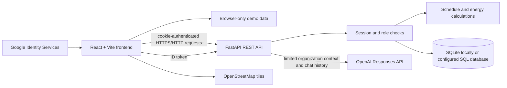
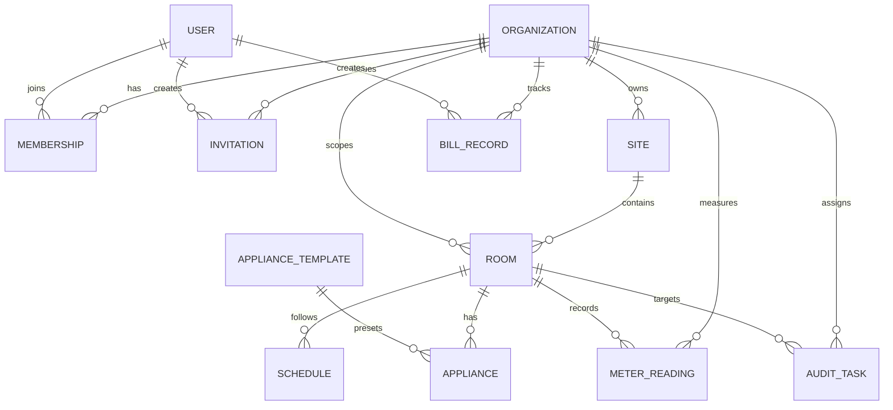

# SyncSpace — Complete Project Guide

This guide describes the current SyncSpace repository: what the application is for, how its parts fit together, how to run it, what data it stores, and what is required to operate it beyond the assignment demo. It is written against the code in this repository; details may change as the project evolves.

## Contents

1. [Project at a glance](#1-project-at-a-glance)
2. [What the application does](#2-what-the-application-does)
3. [Repository map](#3-repository-map)
4. [Architecture and request flow](#4-architecture-and-request-flow)
5. [Roles and access](#5-roles-and-access)
6. [Data model](#6-data-model)
7. [Energy model and calculations](#7-energy-model-and-calculations)
8. [Feature walkthrough](#8-feature-walkthrough)
9. [API reference](#9-api-reference)
10. [Validation and operational limits](#10-validation-and-operational-limits)
11. [Authentication and security](#11-authentication-and-security)
12. [AI energy advisor](#12-ai-energy-advisor)
13. [External services and integrations](#13-external-services-and-integrations)
14. [Run the project locally](#14-run-the-project-locally)
15. [Configuration reference](#15-configuration-reference)
16. [Database behavior and maintenance](#16-database-behavior-and-maintenance)
17. [Build and deployment](#17-build-and-deployment)
18. [Troubleshooting](#18-troubleshooting)
19. [Current limitations and future work](#19-current-limitations-and-future-work)
20. [Glossary](#20-glossary)

## 1. Project at a glance

**SyncSpace** is a web workspace for organizing building locations, facility zones, equipment ratings, operating schedules, electricity-bill records, and team access. It turns entered equipment and schedule data into planning estimates that help a team decide what to inspect first.

The repository supports two ways to use the frontend:

- **Assignment demo:** a sample campus runs in the browser without an account or API server. Its sample facilities and bill records are illustrative. Changes are temporary and are lost when the browser session is reset or closed.
- **Live organization workspace:** users sign in to a FastAPI service. Organization, team, site, zone, schedule, and bill data are saved to the configured database and scoped to the signed-in organization.

The live workspace can optionally use Google Identity Services for sign-in and the OpenAI Responses API for energy-advisor answers. Those services require deployment configuration. The frontend by itself does not provide persistent account data: GitHub Pages hosts static files, while the API and database must run separately.

### What SyncSpace is and is not

SyncSpace is currently a **schedule-and-equipment planning tool**. It does not read a meter, prove a saving, control a building, fetch bills from an electricity provider, or process a payment. A displayed energy gap is a model estimate and should be checked against meter data, operating conditions, and an on-site review.

## 2. What the application does

The main workspace brings these tasks together:

- Review portfolio-level energy-gap, cost, emissions, and schedule-coverage estimates.
- Rank a small number of zones for attention based on their modeled schedule gap.
- View expected hourly equipment demand calculated from schedules; this chart is not a meter trace.
- Compare schedule, lighting, and cooling scenarios with editable assumptions and optional user-entered project cost/payback.
- Estimate rooftop solar size, generation, bill-offset value, and quote-based simple payback.
- Export one portfolio CSV report with totals, the top three ranked zones, and detailed zone estimates.
- Create organization locations and place them on an OpenStreetMap-backed map.
- Set a location pin by clicking a map or pasting a full Google Maps URL with readable coordinates.
- Group zones into blocks and locations, move a zone between locations, and inspect its equipment and timetable.
- Upload a building plan as PNG, JPG, WEBP, or PDF.
- Add schedules individually or import them from CSV.
- Keep an electricity-bill ledger, mark records paid with an external reference, export records, and open an externally hosted provider payment page if one is configured.
- Invite a team and assign owner, admin, manager, or staff roles.
- Ask the optional AI energy advisor about the current organization's schedule-based model and request practical plans or suggestions.

New organizations start with **no sample locations, zones, schedules, or fabricated energy figures**. The organization has default model settings (₹8/kWh tariff, 0.82 kg CO₂e/kWh carbon factor, and 8 operating hours/day) until an owner or admin updates them. Users add their own facility data before the workspace can produce meaningful estimates.

## 3. Repository map

```text
.
├── README.md                       Quick start and deployment notes
├── PROJECT_REPORT.md               ESD assignment report and presentation flow
├── PROJECT_GUIDE.md                This technical and product handbook
├── .github/workflows/
│   └── deploy-pages.yml            Frontend build and GitHub Pages deployment
├── backend/
│   ├── main.py                     FastAPI app, middleware, router registration
│   ├── database.py                 SQLAlchemy engine, connection setup, sessionmaker
│   ├── alembic.ini                 Alembic migration configuration
│   ├── alembic/                    Alembic versioned database migrations
│   │   ├── env.py                  Migration runner with SQLite/Postgres batch support
│   │   └── versions/               Migration scripts (e.g., initial schema + Phase 2/3)
│   ├── models.py                   SQLAlchemy database models (Rooms, Meter, Tasks, etc.)
│   ├── schemas.py                  Pydantic request and response validation
│   ├── crud.py                     Organization-scoped facility and audit operations
│   ├── services.py                 Schedule merge, overlap detection, energy calculations
│   ├── email_service.py            Configurable SMTP transactional mailer (invites, resets, alerts)
│   ├── rate_limiter.py             Sliding-window rate limiter (Redis mandatory in prod + dev fallback)
│   ├── seed_appliances.py          Idempotent localized appliance library seeder
│   ├── auth_security.py            Password hashes, HMAC tokens, signed sessions, role checks
│   ├── routers/
│   │   ├── auth.py                 Signup, login, password reset, team, org settings
│   │   ├── sync.py                 Sites, zones, schedules, CSV import, meter data
│   │   ├── analytics.py            Tasks, bill trends, forecasting, ECBC benchmarking, alerts
│   │   └── advisor.py              Optional AI advisor endpoint
│   ├── tests/                      Automated pytest test suite (25 tests, 0 warnings)
│   │   ├── conftest.py             Test fixtures, in-memory test database, auth headers
│   │   ├── test_energy_calculations.py Standard & edge-case energy calculation tests
│   │   ├── test_api_endpoints.py   Templates, schedule deduplication, meter CSV tests
│   │   ├── test_tasks_and_analytics.py Tasks, anomalies, forecasts, ECBC benchmarks
│   │   ├── test_data_isolation.py  Tenant isolation between distinct organizations
│   │   ├── test_rbac_permissions.py Role boundaries (staff, manager, admin, owner)
│   │   ├── test_schedule_overlap_and_csv.py Schedule overlap collision and malformed CSV
│   │   ├── test_password_reset_and_alerts.py HMAC password reset and alert email dispatch
│   │   ├── test_redis_ratelimit_and_forecast_edge_cases.py Prod Redis enforcement & forecasting
│   │   └── test_migrations_compatibility.py Alembic head & table schema integrity
│   ├── pytest.ini                  Pytest configuration and warning filters
│   ├── requirements.txt            Pinned Python dependencies
│   ├── .env.example                Server configuration template
│   └── timetable.csv               Example schedule data
└── frontend/
    ├── index.html                  HTML shell and application metadata
    ├── package.json                Vite scripts and JavaScript dependencies
    ├── vite.config.js              Vite and GitHub Pages base path
    ├── .env.example                Public frontend configuration template
    └── src/
        ├── App.jsx                 Session, demo, and workspace state
        ├── main.jsx                React entry point
        ├── components/             Screens, charts, maps, forms, advisor, scenarios
        │   ├── ModeledVsMeasuredChart.jsx Recharts interval meter comparison
        │   ├── TaskManager.jsx     Audit task register & before/after savings
        │   ├── BillAnalyticsView.jsx Monthly bill trends, anomalies & forecast
        │   ├── ZoneBenchmarkingModal.jsx ECBC 2017 & BEE regulatory benchmarks
        │   └── ...                 Workspace, maps, and scenario tools
        ├── data/                   Provider directory and demo-only records
        ├── services/api.js         HTTP client and API functions
        ├── utils/energyModel.js    Browser-side estimate calculations
        ├── index.css               Base styling and Tailwind import
        └── experience.css          Workspace, account, map, and advisor styles
```

The frontend folder also contains older standalone components such as `PremiumDashboard.jsx` and `Sidebar.jsx`. The current application entry is `App.jsx`; its signed-in product screen is `EnergyWorkspace.jsx`.

## 4. Architecture and request flow



### Frontend flow

`main.jsx` mounts the React application. `App.jsx` checks for an existing session, displays `AuthScreen` when no session is active, and loads dashboard, sites, zones, and (where permitted) bill records after sign-in. Selecting the demo loads sample objects from `data/demoWorkspace.js` instead of calling account APIs. `EnergyWorkspace.jsx` owns the main product interface and its dialogs.

The HTTP client in `services/api.js` sends requests to `VITE_API_BASE_URL` plus `/api/v1`. In local development, it falls back to port 8000. The browser uses an HTTP-only cookie for the live session; it does not store the password or a bearer token in local storage.

### Backend flow

`main.py` creates the FastAPI app, sets CORS origins, rejects mutating browser requests from unapproved origins, initializes the database, and registers the auth, workspace, and advisor routers. Protected handlers resolve the signed session, active membership, and organization with `auth_security.py`. Data queries then use that organization's ID.

The `services.py` energy calculation is also used by workspace summaries. The frontend has a matching calculation helper for immediate display and for the demo. When adding or changing calculations, keep the client and server implementations consistent.

## 5. Roles and access

| Role | Capabilities |
|---|---|
| **Owner** | Manage organization settings and all roles; manage sites, plans, zones, equipment, schedules, bills, invitations, and members. |
| **Admin** | Manage organization settings, facilities, schedules, bills, managers, and staff. Only the owner can promote or manage another admin. |
| **Manager** | Manage locations, building plans, zones, equipment, schedules, room assignments, and bill records. Cannot administer the team or organization settings. |
| **Staff** | Read locations, zones, plans, schedules, and performance information; use the AI advisor when enabled. Cannot modify workspace records or manage bills/team access. |

Role checks are applied by API dependencies, not only by hiding buttons in the browser. Data handlers also filter by organization. The account flow currently expects a user to have one active workspace membership; accepting an invitation to a different already-active workspace is rejected.

Owners and admins can invite `admin`, `manager`, or `staff` roles; an admin cannot invite another admin. Invitations expire after seven days. The token is shown once in the UI and stored in the database as a SHA-256 digest. The person accepting an invitation must use the invited email. An existing account uses its current password; a new password-based account must meet the strong-password rules.

## 6. Data model



| Entity | Purpose and important fields |
|---|---|
| `Organization` | Workspace name, type, state, flat or time-of-use tariff settings, carbon factor, operating-hours baseline, preferred BBPS partner name, and optional HTTPS portal URL. |
| `User` | Unique email, full name, scrypt password hash, optional unique Google subject, and active/disabled flag. |
| `Membership` | Connects a user and organization with a role and active flag. The user/organization pair is unique. |
| `Invitation` | Organization, target email, role, hashed token, creator, expiry, and accepted timestamp. |
| `Site` | Organization-owned location with address/city/state, optional latitude/longitude, and optional schematic metadata and binary file. |
| `Room` | A facility zone with organization ID, optional site ID, name, block, `zone_type` (e.g. office, classroom, lab, auditorium), and `area_sqm` (floor area in m²). |
| `Appliance` | Equipment name, rated power in watts, load factor, and standby watts, attached to a room. Existing records default to load factor 1.0 and standby 0 W. |
| `ApplianceTemplate` | Localized standard equipment presets (e.g., Split ACs, fans, LED lighting) with default wattage, load factors, standby profiles, and BEE star ratings. |
| `Schedule` | Day label and start/end times, attached to a room. Enforces unique database constraint `uq_schedule_slot` on `(room_id, day_of_week, start_time, end_time)` to eliminate duplicate imports. |
| `MeterReading` | Historical interval meter data uploaded via CSV (no IoT streaming). Stores timestamp, measured kWh, peak kW, power factor, and source filename. Indexed by `(org_id, room_id, timestamp)`. |
| `AuditTask` | Actionable audit register item. Stores title, description, action type, owner, status (open/in_progress/completed/cancelled), priority, due date, baseline reading, post-intervention reading, and verified savings (kWh and ₹). |
| `BillRecord` | Organization-owned biller, state, site label, reference, amount, due date, status, paid date/reference, and creator. |

All entities maintain strict organization-level data isolation. The optional site schematic is stored in the database as a binary column and is deferred from ordinary site queries.

## 7. Energy model and calculations

### Inputs

- Equipment rated power in watts, an operating load factor, and standby watts.
- A zone's weekly timetable.
- The organization's operating-hours baseline in hours/day.
- A flat tariff or peak/off-peak rates with a daily peak time window.
- The organization's emissions factor in kg CO₂e per kWh.

### Equations

1. **Connected capacity (kW)** = sum of equipment rated watts ÷ 1,000.
2. **Estimated active load (kW)** = sum of (rated watts × load factor) ÷ 1,000.
3. **Estimated standby load (kW)** = sum of standby watts ÷ 1,000.
4. **Scheduled hours/day** = non-overlapping weekly timetable minutes ÷ 60 ÷ 7.
5. **Idle hours/day** = max(0, operating-hours baseline − scheduled hours/day).
6. **Modeled idle-time gap (kWh/day)** = max(0, active load − standby load) × idle hours.
7. **Gap cost (₹/day)** = modeled gap × effective tariff (₹/kWh).
8. **Associated emissions (kg CO₂e/day)** = modeled gap × configured emissions factor.
9. **Modeled scheduled energy (kWh/day)** = (active load × scheduled hours) + (standby load × idle hours).
10. **Schedule coverage (%)** = scheduled hours ÷ operating-hours baseline × 100, capped at 100%.

Load factor represents estimated typical active draw divided by rated power and is constrained to 0.05–1.0. Standby watts must be non-negative and no higher than the estimated active draw. New equipment forms start at load factor 1.0 and standby 0 W; these conservative defaults preserve the older rated-load estimate and should be replaced with equipment data when available. Existing database records receive the same values when the application starts after this update.

Overlapping timetable entries are merged before calculating scheduled time. The full weekday names (Monday through Sunday) are recognized, as are `Everyday`, `Daily`, and `All days` (case-insensitive). An end time earlier than a start time represents an overnight interval. Equal start and end times contribute no duration. A schedule longer than the configured baseline produces zero idle hours; the percentage score is capped at 100.

### Worked example

Suppose a zone has 4,500 W rated equipment with a combined load factor of 0.60 and 90 W of declared standby load, six average scheduled hours/day, and an eight-hour baseline. With a flat tariff of ₹8/kWh and 0.82 kg CO₂e/kWh factor:

- Connected capacity = 4.5 kW; estimated active load = 2.7 kW; standby load = 0.09 kW.
- Idle hours/day = 8 − 6 = 2.
- Modeled gap = (2.7 − 0.09) × 2 = **5.22 kWh/day**.
- Modeled cost = 5.22 × 8 = **₹41.76/day**.
- Associated emissions = 5.22 × 0.82 = **4.28 kg CO₂e/day**.
- Modeled scheduled energy = (2.7 × 6) + (0.09 × 2) = **16.38 kWh/day**.

### Tariff behavior

Flat mode uses the configured average rate. Time-of-use mode accepts peak/off-peak rates and a peak start/end time. Because the current schedule-gap calculation has no hourly distribution for idle-time energy, the dashboard uses a **daily duration-weighted blended tariff**: `(peak rate × peak minutes + off-peak rate × remaining minutes) ÷ 1,440`. If peak start and end are equal, the peak period is treated as zero minutes. This is an approximation, not a bill reconstruction or time-resolved tariff calculation. The original flat rate remains stored as the fallback mode.

### What-if and solar scenarios

The What-if tool estimates changes against the current schedule model. Reducing schedule hours shifts the selected active hours to declared standby. Lighting and cooling savings apply only to equipment whose names match the relevant category; their reduction percentages are editable planning assumptions. Cooling savings are calculated from the positive difference between current and scenario setpoints multiplied by a user-adjustable assumed saving per °C, capped at a 50% reduction. The simple payback is only shown when the user enters a one-time cost and modeled monthly savings are positive. These scenarios do not change stored schedules or control equipment.

The rooftop solar estimator uses the user-entered roof area, usable-area percentage, and area density in m²/kWp to estimate system size. Its editable yield defaults to 4.75 kWh/kWp/day, centered in the 4.5–5.0 range supplied for Kolkata. It estimates a 30-day generation and bill-offset value at the workspace effective tariff. It assumes every generated kWh offsets grid purchases; exports, self-consumption timing, shading, roof orientation/tilt, structural suitability, local approvals, system losses, and actual project prices are not modeled. Payback requires an installer quote per kWp entered by the user. The 9.3 m²/kWp initial area-density value is a broad planning reference derived from the U.S. Department of Energy consumer guidance of about 100 sq ft per kW; users should replace it with an installer design appropriate to their site and module choice ([DOE consumer guide](https://www1.eere.energy.gov/solar/pdfs/43844.pdf)).

The hourly schedule profile uses estimated active load spread over the timetable. It is not a live electrical demand curve. A result is a **planning estimate**, not measured consumption, verified waste, a formal emissions inventory, or guaranteed savings. Actual loads may be lower due to cycling, modulation, shutdowns, or operating conditions. The project currently accepts schedule CSVs only and does not connect an IoT meter. Validate through interval-meter data, occupancy, operating procedures, and site inspection before reporting savings.

## 8. Feature walkthrough

### 8.1 Signup and sign-in

Users can create a workspace with an email/password account or Google signup, then sign in with email/password or Google. Password signup asks for a new password twice and displays a live strength meter. Owners/admins can create invitation links for teammates.

### 8.2 Portfolio overview and action center

The overview summarizes the zones currently loaded for the organization. The action center ranks the first three zones with a positive modeled gap, from largest to smallest, and opens zone detail for review. Empty organizations show empty-state guidance instead of sample values.

### 8.3 Locations and map pins

Locations are organization-owned. A pin is optional. The location form offers a click-on-map picker or a full Google Maps link with coordinates. The map picker uses OpenStreetMap tiles and defaults to an India-wide view. A shortened Google Maps sharing URL generally does not contain coordinates the browser can parse; open it in Google Maps and copy the full address-bar URL, or mark the spot on the map.

The portfolio map displays mapped sites and groups zones by building/block. A zone can be assigned to a different site. Map pins and addresses are visible to members of the owning organization.

### 8.4 Zones, equipment, and timetables

Create a zone with a name, block, optional site selection (the UI selects a site), and equipment items with rated watts, load factor, and standby watts. Then import one or more timetable rows. Once equipment and schedules are saved, the zone and portfolio estimates can be calculated. The zone detail view displays equipment assumptions, schedule entries, an estimated daily gap, and a shortcut to import a timetable. New equipment starts at load factor 1.0 and standby 0 W so existing assumptions are not replaced with invented device behavior.

### 8.5 Schedule CSV import

The selected zone is supplied in the UI; it is not a CSV column. The CSV must contain:

```csv
day_of_week,start_time,end_time
Monday,09:00,17:00
Tuesday,09:00,17:00
Wednesday,09:00,17:00
Thursday,09:00,17:00
Friday,09:00,17:00
```

The import accepts UTF-8 (including a UTF-8 BOM), requires the three headers, validates each row, and appends the parsed schedules to the selected zone. A file can be up to 10 MiB. The API reports the first invalid CSV row. Re-importing the same rows is not automatically deduplicated; overlapping intervals are merged by the calculation but the rows remain in the database.

### 8.6 Electricity ledger

Managers, admins, and owners can add bill records, filter by due/paid/archived state, export records, and reconcile a paid bill with an external payment reference. Archived records are marked `void`. Owners/admins can configure a partner label and an HTTPS provider portal URL. Opening that URL leaves SyncSpace for the provider page. SyncSpace does not fetch bill data, call BBPS, move money, or verify a provider's payment.

### 8.7 Team management

Owners and admins can list team members, issue/revoke invitations, change permitted roles, or suspend a membership. Invitation delivery is not automated: the application shows the one-time invitation link for the admin to share. The recipient must open the deployed application origin that matches the organization's deployment.

### 8.8 Ask AI energy advisor

The floating **Ask AI** entry point offers energy, cost, and planning prompts. In a live workspace, the API builds context from the current organization and sends the question plus recent chat history to the AI provider. The demo does not call the AI service. See [AI energy advisor](#12-ai-energy-advisor) for configuration, privacy, and usage limits.

### 8.9 Assignment demo

The sample campus, locations, schedules, bills, and team are defined in `frontend/src/data/demoWorkspace.js`. The demo avoids the API and uses in-memory browser state. Its figures and coordinates are fabricated for demonstration and are separate from live organization records.

### 8.10 What-if, rooftop solar, and report export

**What-if tools** compare the current schedule baseline with per-zone runtime reductions and user-selected lighting/cooling assumptions. An appliance name must match a lighting or cooling keyword for those controls to include it. A schedule must exist for the zone. Daily and 30-day savings use the effective tariff and configured carbon factor; simple payback requires a user-entered cost.

**Rooftop solar** takes total roof area, the share considered usable, area per kWp, and a daily yield between 4.5 and 5.0 kWh/kWp for the Kolkata planning view. The default yield is 4.75. The initial 9.3 m²/kWp area density is editable, and bill value assumes all generation displaces grid purchases. Enter an installer quote per kWp to calculate simple payback. This is a screening estimate, not a site design.

**Report CSV** is available to every signed-in workspace role. It includes organization assumptions and generation time, portfolio gap/cost/emissions/schedule totals, the top three zones by modeled gap, and all zone estimates. CSV cells are escaped to reduce spreadsheet formula execution risk.

### 8.11 Localized appliance library

SyncSpace includes a pre-populated database library of standard Indian commercial appliances (Split ACs, BLDC and standard ceiling fans, LED tube lights, commercial troffers, computer workstations, servers, and pantry appliances). When creating a zone, users can select an appliance template from the library dropdown to automatically populate rated wattage, typical operating load factors (e.g. 0.60 for ACs), and standby wattage (e.g. 15W idle electronics).

### 8.12 Historical interval meter CSV & Modeled vs Measured analytics

To ensure defensible energy management without relying on live IoT hardware integrations, SyncSpace accepts interval meter data CSV uploads. 
- CSV format: `timestamp,measured_kwh,peak_kw,power_factor`
- Analyzes daily interval consumption and plots an interactive Recharts dual-series comparison: **Modeled schedule baseline** vs **Measured real-world consumption**.
- Calculates the empirical deviation (variance percentage and total gap delta), allowing energy managers to validate theoretical idle-gap assumptions against measured utility reality.

### 8.13 Actionable task & audit register

Energy audits require concrete corrective actions with measurable proof of savings.
- Task register with properties: Title, Description, Action Type (HVAC setpoint, LED upgrade, timer installation, insulation, behavioral), Owner, Priority, Due Date, and Status (Open, In Progress, Completed, Cancelled).
- Measurement & Verification (M&V): Managers record **baseline pre-intervention meter readings** and **post-intervention meter readings**.
- The system automatically calculates and records verified savings in both **kWh saved** and **₹ saved**, providing audit proof for ESG and financial reporting.

### 8.14 Electricity bill trends & 20% rolling-average anomaly detection

The electricity ledger displays historical monthly billing records with an interactive chart tracking monthly kWh and bill amounts (₹).
- Features an automated statistical anomaly detection algorithm: any billing month where the consumption exceeds the 3-month rolling average by **>20%** is visually flagged with an anomaly badge.
- Alerts energy managers to unexplained utility spikes, meter billing errors, or unnoticed operational changes.

### 8.15 Next-month predictive forecasting

SyncSpace provides a lightweight local Machine Learning regression model that analyzes the organization's historical bill ledger to forecast next-month energy consumption (kWh) and estimated cost (₹).
- Uses linear regression with slope, intercept, and $R^2$ goodness-of-fit confidence score.
- Reports direction of trend (Increasing, Decreasing, or Stable) on the executive dashboard.

### 8.16 ECBC 2017 & BEE regulatory benchmarking

Zones can be benchmarked against statutory Indian energy efficiency standards:
- **Energy Conservation Building Code (ECBC 2017)** published by the Bureau of Energy Efficiency (BEE), Ministry of Power, Government of India.
- Evaluates the zone's Energy Performance Index (**EPI** in kWh/m²/year) against specific building space categories (Commercial Office: 140 kWh/m²/yr; Education: 100 kWh/m²/yr; Labs: 160 kWh/m²/yr; Healthcare: 200 kWh/m²/yr; Retail: 180 kWh/m²/yr; IT/Datacenters: 400 kWh/m²/yr).
- Automatically calculates compliance deviation (%) and classifies the zone into **Efficient**, **Standard Compliance**, or **Inefficient / High Consumption** ratings with full regulatory citations.

## 9. API reference

All product routes are under `/api/v1`; the API client appends this prefix to the configured API root. `GET /` is a basic service health response. The API also serves OpenAPI documentation at `/docs` when running locally.

### Authentication and organizations

| Method and path | Purpose | Access |
|---|---|---|
| `POST /auth/register` | Create an email/password owner and a new empty organization. | Public; duplicate email returns a conflict. |
| `POST /auth/login` | Sign in with email and password. | Public, rate-limited by IP/email (Redis + in-memory fallback). |
| `POST /auth/forgot-password` | Request HMAC-signed password reset link via SMTP. | Public, rate-limited by IP/email. |
| `POST /auth/reset-password` | Set new password using verified, unexpired HMAC reset token. | Public with valid single-use token. |
| `POST /auth/google/register` | Verify a Google ID token and create an owner workspace. | Public, requires Google client configuration. |
| `POST /auth/google/login` | Verify Google identity and create a session for an existing workspace. | Public, requires Google client configuration. |
| `POST /auth/register-invitation` | Accept a valid invitation and join the organization. | Public with a single-use invitation token. |
| `POST /auth/logout` | Clear the browser's session cookie. | Session. |
| `GET /auth/me` | Return current user, organization, and role. | Any active member. |
| `PATCH /auth/organization` | Update organization identity, flat or time-of-use tariff settings, carbon factor, operating baseline, or bill portal settings. | Owner/admin. |
| `GET /auth/members` | List workspace memberships. | Owner/admin. |
| `PATCH /auth/members/{membership_id}` | Change a permitted team role. | Owner/admin, with owner/admin restrictions. |
| `DELETE /auth/members/{membership_id}` | Suspend a membership. | Owner/admin, with owner/admin restrictions. |
| `POST /auth/invitations` | Create a seven-day invitation and return its token once (optionally triggers SMTP email). | Owner/admin. |
| `GET /auth/invitations` | List outstanding invitations. | Owner/admin. |
| `DELETE /auth/invitations/{invitation_id}` | Revoke an invitation. | Owner/admin. |

### Facilities, schedules, appliance library, and meter data

| Method and path | Purpose | Access |
|---|---|---|
| `GET /appliance-templates/` | List pre-populated Indian appliance library templates. | Any active member. |
| `GET /sites/` | List the organization's sites. | Any active member. |
| `POST /sites/` | Create a site. | Owner/admin/manager. |
| `PATCH /sites/{site_id}/` | Update a site. | Owner/admin/manager. |
| `POST /sites/{site_id}/schematic/` | Upload a building plan. | Owner/admin/manager. |
| `GET /sites/{site_id}/schematic/` | Read a plan in the organization. | Any active member. |
| `DELETE /sites/{site_id}/schematic/` | Remove a plan. | Owner/admin/manager. |
| `GET /rooms/` | List zones with equipment, schedules, zone_type, and area_sqm. | Any active member. |
| `POST /rooms/` | Create a zone with zone_type, area_sqm, and initial equipment. | Owner/admin/manager. |
| `PATCH /rooms/{room_id}/site/` | Move a zone to a site. | Owner/admin/manager. |
| `POST /rooms/{room_id}/appliances/` | Add equipment to a zone. | Owner/admin/manager. |
| `POST /rooms/{room_id}/schedules/` | Add a schedule row (checks `uq_schedule_slot` uniqueness & rejects interval overlaps with HTTP 409). | Owner/admin/manager. |
| `POST /rooms/{room_id}/schedules/upload/` | Import schedule rows from CSV with exact deduplication (`skipped_duplicates`) and interval overlap skips (`skipped_overlaps`). | Owner/admin/manager. |
| `POST /meter-data/upload/` | Upload historical interval meter data CSV for a zone. | Owner/admin/manager. |
| `GET /meter-data/readings/` | Retrieve parsed historical meter interval readings. | Any active member. |
| `GET /meter-data/summary/` | Get Modeled vs Measured analytics and daily interval comparison. | Any active member. |
| `GET /rooms/{room_id}/waste-analysis/` | Calculate one zone's estimates. | Any active member. |
| `GET /campus-dashboard/` | Aggregate zone estimates for the workspace. | Any active member. |

### Audit tasks, bill analytics, and benchmarking

| Method and path | Purpose | Access |
|---|---|---|
| `GET /tasks/` | List organization audit tasks with before/after readings & verified savings. | Any active member. |
| `POST /tasks/` | Create an actionable audit task. | Owner/admin/manager. |
| `PUT /tasks/{task_id}/` | Update task status, owner, readings, and record verified savings. | Owner/admin/manager. |
| `DELETE /tasks/{task_id}/` | Delete an audit task. | Owner/admin/manager. |
| `GET /analytics/bill-trends/` | Monthly bill trend history with >20% rolling-average anomaly flags. | Owner/admin/manager. |
| `GET /analytics/forecast/` | Next-month bill consumption and cost forecast with linear regression & $R^2$. | Owner/admin/manager. |
| `GET /analytics/benchmarks/{room_id}` | Compare zone EPI against ECBC 2017 & BEE regulatory baselines (statutory vs indicative). | Any active member. |
| `POST /analytics/alerts/dispatch/` | Trigger automated email alerts for upcoming bill due dates (<7 days) and high energy gaps (>50 kWh/d). | Owner/admin/manager. |

### Electricity ledger and advisor

| Method and path | Purpose | Access |
|---|---|---|
| `GET /bill-records/` | List organization bill records. | Owner/admin/manager. |
| `POST /bill-records/` | Add a bill record. | Owner/admin/manager. |
| `PUT /bill-records/{record_id}/payment` | Mark paid and record the external reference. | Owner/admin/manager. |
| `PATCH /bill-records/{record_id}` | Change bill status, currently used to archive/void. | Owner/admin/manager. |
| `POST /advisor/chat` | Request a workspace-aware advisor answer (rate-limited via Redis/in-memory). | Any active member; requires `OPENAI_API_KEY`. |

The route schemas in `backend/schemas.py` define the authoritative request constraints. Every protected operation should keep organization scoping in its database queries; do not rely on client-provided organization IDs.

## 10. Validation and operational limits

| Data | Current validation / limit |
|---|---|
| Account email | 3–254 characters and checked against an email pattern. |
| New account password | 12–128 characters; requires lowercase, uppercase, ASCII digit, and symbol. Password login accepts the existing stored password as entered. |
| Organization | Name 2–120 characters; type 2–60; state 2–80; flat/peak/off-peak rates 0–1,000; tariff mode is flat or time-of-use; carbon factor 0–3; operating hours greater than 0 and up to 24. |
| Site | Name 2–120; address up to 240; city up to 100; state 2–80; latitude −90 to 90 and longitude −180 to 180. Either both coordinates or neither. |
| Zone | Name and block required, each up to 120; site ID optional at schema level. |
| Equipment | Name 1–120; power greater than 0 and up to 10,000,000 W; load factor 0.05–1.0; standby watts 0 through estimated active load; up to 50 items on a single zone-creation request. |
| Timetable | Day label 2–24; valid time values. CSV file maximum 10 MiB. |
| Building plan | PNG/JPG/WEBP/PDF, extension and content signature checked, maximum 10 MiB. |
| Bill record | Positive amount up to ₹1,000,000,000; biller/state and due date required. |
| Invitation | Token is hashed in storage, expires in seven days, and must match the invited email. |
| AI question | 1–1,200 characters; up to 10 history items of up to 2,000 characters each; model output capped at 700 tokens. |

## 11. Authentication and security

- Passwords are stored as salted `scrypt` hashes; the raw password is not stored.
- Password-based signup checks the strength requirements in both the browser and API. Password login is not forced to match the current signup rules, allowing existing accounts to keep logging in.
- Session tokens are signed with HMAC-SHA256 and placed in an HTTP-only, SameSite=Lax cookie. The configured lifetime is 12 hours. The Secure cookie attribute is enabled when `APP_ENV=production`.
- Password reset tokens are generated using timestamped HMAC-SHA256 signatures with a 1-hour expiration. Tampered tokens, expired tokens, and mismatched signatures are securely rejected without leaking account existence.
- Production startup fails if `AUTH_SECRET_KEY` is absent or shorter than 32 characters. Without a configured key in development, a random key is generated at process start; restarting the API can invalidate development sessions.
- Google credentials are verified on the API against `GOOGLE_CLIENT_ID`; the browser client ID is public configuration. Google subjects are stored as stable identity references. A verified Google email can be linked to an existing password account.
- **Production Redis enforcement:** When `APP_ENV=production`, `REDIS_URL` is mandatory. The application verifies the Redis connection upon startup and refuses in-memory fallback. If Redis is unavailable in production, requests return HTTP 503 Service Unavailable. The in-memory sliding window limiter is strictly retained as a fallback for local development and test environments.
- Login and Google identity attempts are limited to 10 attempts per 15-minute window per limiter key. AI questions are limited to 10 requests per user per minute.
- Membership state and role are rechecked on protected API requests. Facility, schedule, task, and bill queries remain organization-scoped to guarantee complete multi-tenant isolation.
- CORS is credential-enabled for configured `FRONTEND_ORIGINS`. Mutating requests with an `Origin` header outside that list are rejected by middleware.
- Uploaded schematics are type/signature checked, returned with `nosniff`, private cache policy, and a sandbox content policy.
- Invitation tokens are returned once, stored hashed, and limited to the invited email.
- API secrets belong only on the API server. Do not put `AUTH_SECRET_KEY`, `OPENAI_API_KEY`, or a Google client secret in frontend code or GitHub Pages variables.

The session system is application-specific; use HTTPS in production and configure the persistent database, Redis cluster, and stable secrets before putting a workspace into real operation.

## 12. AI energy advisor

### What it uses

`POST /api/v1/advisor/chat` verifies the signed-in membership and constructs a limited summary from that user's organization:

- Organization settings used by the energy model.
- Location names and regions (up to 60 included in the prompt).
- Zone names, block/location, equipment counts, connected loads, schedule coverage, and estimated idle energy/cost. Up to 500 zones are evaluated and the 25 largest modeled gaps are included in the prompt; truncation is indicated.
- Aggregate bill count, due count, and due amount. Individual bill references and payment references are not included.
- The current question and recent chat history supplied by the browser.

The system instructions direct the model to distinguish estimates from meter readings, avoid inventing workspace facts, treat workspace text and chat history as untrusted data, give concise operational suggestions, and refer electrical work to qualified staff. The request uses the OpenAI Responses API, sets `store: false`, and caps generated output. The app does not persist chat history; it is held in frontend memory for the current page session.

### Enable it

1. Create an OpenAI API key in the OpenAI Platform.
2. Add it to `backend/.env` or your API host environment as `OPENAI_API_KEY`.
3. Optionally set `OPENAI_MODEL`; the current default is `gpt-6-luna`.
4. Restart the API service.
5. Sign into a non-demo workspace whose API connection is online and open **Ask AI**.

Requests are limited to 10 per user per minute in each API process. The model provider may charge for input and output tokens under the account attached to the API key. Workspace summaries and chat messages are transmitted to the configured provider to generate answers; users should not include personal or confidential material. The demo disables live chat so it cannot spend provider credits anonymously.

## 13. External services and integrations

| Service | Current use | Required configuration / boundary |
|---|---|---|
| Google Identity Services | Browser sign-in/signup credential; API verifies the ID token. | Same Google web client ID in `VITE_GOOGLE_CLIENT_ID` and `GOOGLE_CLIENT_ID`; register frontend JavaScript origins. |
| OpenAI Responses API | Optional, authenticated AI energy-advisor responses. | Server-only `OPENAI_API_KEY`; usage can incur charges. |
| OpenStreetMap | Map tiles and site-map display through Leaflet. | No Google Maps API key; internet access is needed to load map tiles. |
| Electricity provider directory | Curated static state/UT provider names and reference links in frontend data. | No live provider lookup or billing integration. |
| Provider payment portal | Opens a configured HTTPS URL supplied by the organization. | External page only; no payment request or confirmation is handled by SyncSpace. |
| Google Maps URLs | Optional source of coordinates when the user pastes a full link with a readable pin. | Shortened sharing links often do not expose coordinates to the browser. |
| GitHub Pages | Hosts the built static frontend from `main`. | FastAPI and the production database must be hosted separately for accounts. |

## 14. Run the project locally

Use two PowerShell terminals from the repository folder `D:\energy management`.

### Terminal 1 — API

Run these once to create the Python environment and install dependencies:

```powershell
cd "D:\energy management\backend"
py -m venv .venv
.\.venv\Scripts\python.exe -m pip install -r requirements.txt
```

Then start the API (leave this terminal open):

```powershell
.\.venv\Scripts\python.exe -m uvicorn main:app --reload --host 127.0.0.1 --port 8000
```

Local API health check: `http://127.0.0.1:8000/`. Interactive API docs: `http://127.0.0.1:8000/docs`.

### Terminal 2 — frontend

Run `npm install` once, then start Vite (leave this terminal open):

```powershell
cd "D:\energy management\frontend"
npm install
npm run dev -- --host 127.0.0.1
```

Open `http://127.0.0.1:5173/`. A browser-only assignment demo can be opened without starting the API; account signup and live workspace persistence require both services. If the frontend port is not serving a page, restarting the frontend terminal will not restart the API, and vice versa.

### Optional local environment files

Copy `backend/.env.example` to `backend/.env` for server settings and `frontend/.env.example` to `frontend/.env.local` for build-time frontend settings. `.env` files are ignored by Git. To enable Google login, set the same web client ID in both files. To enable AI answers, set `OPENAI_API_KEY` only in `backend/.env`. Restart Vite after changing `VITE_*` variables and restart FastAPI after changing server variables.

## 15. Configuration reference

| Variable | Used by | Purpose |
|---|---|---|
| `DATABASE_URL` | API & Alembic | SQLAlchemy connection string. Defaults to `sqlite:///./syncspace.db`. PostgreSQL URLs beginning `postgresql://` are adapted to the psycopg driver. |
| `APP_ENV` | API | Set `production` to require a stable auth secret and mark the session cookie Secure. |
| `AUTH_SECRET_KEY` | API | HMAC signing secret. Must be at least 32 characters in production. Generate a private random value; never commit it. |
| `FRONTEND_ORIGINS` | API | Comma-separated exact origins allowed by CORS and mutation middleware, including scheme and port when applicable. |
| `GOOGLE_CLIENT_ID` | API | Audience expected for Google ID tokens. |
| `OPENAI_API_KEY` | API | Server credential for the AI advisor. Never expose this to browser code. |
| `OPENAI_MODEL` | API | OpenAI model identifier; defaults to `gpt-6-luna`. |
| `REDIS_URL` | API | Redis connection string (e.g. `redis://localhost:6379/0`). **Mandatory in production** (`APP_ENV=production`); the API tests connectivity on startup and returns HTTP 503 if unreachable. In development/testing, falls back gracefully to an in-memory sliding-window store. |
| `SMTP_HOST` | API | SMTP server host (e.g. `smtp.sendgrid.net`, `smtp.gmail.com`). Powers team invitations, password resets, and automated bill/energy alerts. If omitted, emails are logged as dry-runs. |
| `SMTP_PORT` | API | SMTP server port; defaults to 587. |
| `SMTP_USER` | API | Username or API key for SMTP authentication. |
| `SMTP_PASSWORD` | API | Password or secret for SMTP authentication. |
| `SMTP_FROM` | API | From email address header (defaults to `SyncSpace Alerts <no-reply@syncspace.energy>`). |
| `SMTP_TLS` | API | Whether to enforce STARTTLS encryption (`true` or `false`, defaults to `true`). |
| `VITE_API_BASE_URL` | Frontend build | Public API root URL without `/api/v1`; the client adds that prefix. |
| `VITE_GOOGLE_CLIENT_ID` | Frontend build | Public Google web client ID used by Google Identity Services in the browser. |
| `VITE_BASE_PATH` | Frontend build | Vite base URL; GitHub Pages sets this to `/ENERGY/`. Local default is `/`. |

For production, configure environment variables on the backend hosting service. Configure only public frontend variables as GitHub repository variables. In GitHub Actions, `VITE_API_BASE_URL` and `VITE_GOOGLE_CLIENT_ID` are passed to the Pages build. The API key, database credentials, and session key do not belong in that workflow.

## 16. Database behavior and maintenance

### Versioned database migrations (Alembic)

The application uses **Alembic** for schema migrations across both SQLite and PostgreSQL backends:
- Migration files are stored under `backend/alembic/versions/`.
- Configured with `render_as_batch=True` to support SQLite schema alterations transparently.
- To apply migrations to the current database:
  ```powershell
  cd "D:\energy management\backend"
  .\.venv\Scripts\python.exe -m alembic upgrade head
  ```
- To generate a new migration after editing `models.py`:
  ```powershell
  .\.venv\Scripts\python.exe -m alembic revision --autogenerate -m "describe_changes"
  ```

Startup code in `database.py` establishes the engine and pool connections cleanly without executing destructive or unversioned manual schema patches.

### Pre-populated appliance library seed

To populate or refresh the standard Indian commercial appliance template library:
```powershell
cd "D:\energy management\backend"
.\.venv\Scripts\python.exe seed_appliances.py
```
This script is idempotent: running it multiple times checks existing entries by appliance name and adds only missing standard presets without duplicating rows.

### Data storage and backups

Local SQLite data is stored at `backend/syncspace.db` by default (relative to the backend working directory). Protect and back up this file if it contains real workspace data. For a hosted multi-user system, use a persistent database service (e.g. PostgreSQL), a managed backup policy, and tested restore procedures.

## 17. Build, testing, and deployment

### Frontend checks, performance, and build

From `frontend/`:

```powershell
npm run lint
npm run build
npm run preview
```

`npm run build` writes static assets to `frontend/dist`; `npm run preview` serves that built output locally.

**Code-splitting & Bundle Optimization:**
- Configured Vite with Rollup `manualChunks` to split the frontend into four dedicated vendor chunks: `vendor-charts` (Recharts & D3 dependencies), `vendor-react` (React core & DOM), `vendor-icons` (Lucide React), and `vendor-misc`.
- Implemented `React.lazy()` and `Suspense` code splitting on heavy interactive modals like `ZoneBenchmarkingModal.jsx`.
- Result: Completely eliminated the monolithic 809 kB single-chunk warning; maximum single chunk reduced to 381 kB (`vendor-charts`), with total build time under 1.0s and 0 warnings.

### Automated backend test suite (Pytest)

From `backend/`:

```powershell
.\.venv\Scripts\python.exe -m pytest -v
```

The comprehensive automated test suite includes **25 tests across 8 test suites**, running with **0 warnings** on Python 3.14 (fully timezone-aware UTC timestamps, zero deprecated `datetime.utcnow()` references):

1. **Exact standard energy calculation (`test_energy_calculations.py`):**
   $$\text{4.5 kW connected load} \times \text{2 idle hours} = \text{9.0 kWh}$$
   $$\text{9.0 kWh} \times \text{₹8/kWh} = \text{₹72.0}$$
   $$\text{9.0 kWh} \times \text{0.82 kg CO}_2\text{e/kWh} = \text{7.38 kg CO}_2\text{e}$$
2. **Load factors and standby watt models:** Active kW vs Standby kW baseline calculations.
3. **Schedule interval merging:** Correct union of overlapping timetable slots.
4. **Time-of-Use blended tariff calculations:** Peak vs Off-peak weighted cost estimates.
5. **Appliance template retrieval (`test_api_endpoints.py`):** Verified 16 localized Indian equipment presets.
6. **Schedule deduplication & DB constraints:** Enforces `uq_schedule_slot` unique constraint.
7. **Interval meter data CSV upload:** CSV schema validation and dual-series Modeled vs. Measured variance summary.
8. **Multi-tenant organization data isolation (`test_data_isolation.py`):** Zero cross-tenant leakage between Organization A and Organization B across rooms, appliances, schedules, tasks, and bills.
9. **Role-based access control (`test_rbac_permissions.py`):** Strict authorization verification for staff (read-only), manager (facilities, tasks, schedules, bills), and owner/admin (team invitations and org settings).
10. **Schedule overlap collision detection (`test_schedule_overlap_and_csv.py`):** Minute-by-minute interval collision detection rejecting overlaps with HTTP 409 Conflict, handling overnight shifts, and counting `skipped_overlaps` on CSV import.
11. **Malformed CSV input validation:** Rejection of invalid headers, corrupted time formats, and empty files.
12. **Password reset workflow (`test_password_reset_and_alerts.py`):** HMAC-SHA256 timestamped tokens, password reset execution, single-use invalidation, and tampered token detection.
13. **Automated scheduled alerts:** Dispatching email warnings for impending bill due dates (<7 days) and high energy gaps (>50 kWh/day).
14. **Production Redis enforcement (`test_redis_ratelimit_and_forecast_edge_cases.py`):** Ensures production mode refuses in-memory fallback and raises 503 if Redis is unreachable.
15. **Sliding-window rate limiter:** Accurate burst and replenishment throttling in development mode.
16. **Predictive forecasting edge cases:** Clean handling of 0 bills (None), 1 bill (fallback single-point forecast), and multi-bill linear regression ($R^2 > 0.8$).
17. **Alembic migration compatibility (`test_migrations_compatibility.py`):** Head revision `5d7c26b5329f` verification and table/constraint schema inspection.
18. **Actionable task & audit register (`test_tasks_and_analytics.py`):** Full lifecycle from OPEN to COMPLETED, verifying before/after meter readings and calculated savings.
19. **Bill anomaly detection:** Statistical flagging for electricity bills >20% above the 3-month rolling average.
20. **Next-month consumption & cost forecasting:** Multi-month linear regression projection.
21. **ECBC 2017 & BEE regulatory benchmarking:** Classifies spaces against authoritative statutory codes vs indicative benchmarks.

### Automated CI/CD workflows

- **`.github/workflows/test.yml`**: Triggers on push and pull request. Sets up Python, installs dependencies, and runs the full Pytest automated test suite.
- **`.github/workflows/deploy-pages.yml`**: Installs frontend dependencies with `npm ci`, builds production assets, and publishes `frontend/dist` to GitHub Pages.

### Production checklist

Before enabling account workspaces on a public deployment:

1. Host the API at a public HTTPS origin and the database on persistent storage.
2. Set `APP_ENV=production`, a stable `AUTH_SECRET_KEY` (32+ characters), `DATABASE_URL`, exact `FRONTEND_ORIGINS`, and any provider keys needed by the enabled features.
3. If using Google auth, configure `GOOGLE_CLIENT_ID` on the API and `VITE_GOOGLE_CLIENT_ID` as a GitHub repository variable, then add the frontend origin to the Google OAuth client's authorized JavaScript origins.
4. If using AI, set `OPENAI_API_KEY` on the API host only and confirm the selected model is enabled for that OpenAI account.
5. Set `VITE_API_BASE_URL` to the API root as a GitHub repository variable; do not append `/api/v1`.
6. Verify CORS origins, HTTPS cookies, API health, backup/restore, and a real end-to-end account flow in a non-production environment.

GitHub Pages alone can show the demo but cannot provide saved account data. The repository currently contains no backend hosting workflow; API hosting and its environment must be maintained separately.

## 18. Troubleshooting

| Symptom | Checks |
|---|---|
| Browser shows a blank page at `localhost:5173` | Confirm the frontend terminal is running and Vite reports port 5173; try refreshing the page. The API being active at port 8000 does not serve the frontend. Check the browser console if the Vite server is healthy but React still fails to render. |
| Account page says the workspace service is unavailable | Start the API on port 8000; check `http://127.0.0.1:8000/`; confirm `VITE_API_BASE_URL` and `FRONTEND_ORIGINS`; restart services after environment changes. |
| Login works but no facility data appears | A new organization is intentionally empty. Add a location, create zones, add rated equipment, and import schedules. |
| Estimates are zero or unexpectedly small | Check equipment watt values, schedule day labels/times, operating baseline, tariff, and carbon factor. Verify schedules belong to the selected zone. |
| Google button says setup is needed | Set the matching web client ID on frontend and API, register the browser origin, and restart both services/rebuild the static frontend. |
| Google token fails verification | Confirm `GOOGLE_CLIENT_ID` and `VITE_GOOGLE_CLIENT_ID` are the same client, Google Identity Services is enabled, and the current page origin is authorized. |
| AI advisor reports it is not configured | Put `OPENAI_API_KEY` on the backend host and restart the API; verify the model name and provider usage/billing status. |
| Map link is rejected | Use the map picker or paste a full Google Maps URL with a dropped pin; shortened share links may hide coordinates until opened in Maps. |
| CSV import reports an invalid row | Check that the three required headers exist, day names are supported, times parse as `HH:MM`/valid time values, and the file is UTF-8. |
| Building-plan upload is rejected | Use PNG/JPG/WEBP/PDF, ensure the file signature matches its extension, and keep it at or below 10 MiB. |
| Browser changes are missing after reload in demo | Demo changes are temporary by design. Sign into a live workspace to save data through the API. |

## 19. Current boundaries, regulatory baselines, and future work

### Current product boundaries

- **Hardware boundary:** No live IoT hardware streaming (e.g. no microcontrollers, Arduino, ESP32, or raw socket listeners). All real-world measured data comparison is strictly handled via structured CSV interval imports.
- **Billing payments boundary:** No automated payment gateway execution or live BBPS money movement; payments occur on authorized provider portals and are reconciled with external transaction references.
- **AI integration:** Chat requires an external OpenAI API key and active network connectivity.
- **What-if & solar:** What-if models simulate scenario assumptions on stored schedules; rooftop solar provides screening-level feasibility estimates and requires formal on-site structural/electrical design for execution.

### Authoritative regulatory baselines (ECBC 2017 & BEE)

SyncSpace benchmarks facility zones against statutory Indian energy efficiency standards without fabricating metrics, maintaining a clear architectural distinction between statutory building codes and indicative space-level audit baselines:

1. **Statutory Building Standards (ECBC 2017 & BEE Star Rating):**
   - **Legal Mandate:** Applies to commercial buildings with connected electrical load $\ge 100\text{ kW}$ or contract demand $\ge 120\text{ kVA}$ under the Energy Conservation Act (EC Act 2001, amended 2022).
   - **Source:** *Energy Conservation Building Code (ECBC 2017)* Section 3 & Appendix E (Whole Building Performance method), Bureau of Energy Efficiency (BEE), Ministry of Power, GoI.
   - **Climate Zone Context:** Baseline indices represent the **Composite / Warm-Humid Standard** prevailing in major Indian urban centers.
   - **Whole-Building Categories:**
     - **Commercial Offices:** 140 kWh/m²/yr (Standard ECBC compliant); 115 kWh/m²/yr (ECBC+ / BEE 4-Star); 90 kWh/m²/yr (Super ECBC / BEE 5-Star).
     - **Healthcare & Hospital Buildings:** 200 kWh/m²/yr.
     - **Retail & Commercial Centers:** 180 kWh/m²/yr.
     - **Hospitality & Hotel Buildings:** 300 kWh/m²/yr.

2. **Indicative Space-Type Baselines (BEE Audit & ECO-III Standards):**
   - **Operational Scope:** Sub-space performance metrics derived from USAID/BEE ECO-III Energy Benchmarking manuals and comprehensive facility energy audits. These serve as indicative operational guidelines for specific rooms/functional zones rather than statutory whole-building mandates:
     - **Educational Classrooms:** 95 kWh/m²/yr.
     - **Educational & Academic Buildings (General):** 100 kWh/m²/yr.
     - **Science & Computer Laboratories:** 160 kWh/m²/yr.
     - **IT & High-Density Data Centers:** 400 kWh/m²/yr.
     - **Logistics & Warehousing:** 50 kWh/m²/yr.

The UI badges each benchmark accordingly, ensuring energy managers understand whether an index reflects statutory compliance or an indicative operational baseline.

### Completed enhancements (Phases 2, 3, 4, and Critical Engineering Audit)

1. **Alembic Database Migrations:** Versioned, idempotent migrations replacing startup schema patches; full SQLite batch and PostgreSQL support (head revision `5d7c26b5329f`).
2. **Pre-Populated Appliance Library:** 16 standard Indian commercial appliances with rated power, typical load factors, and standby profiles.
3. **Database Constraints & Interval Overlap Detection:** Unique database constraint `(room_id, day_of_week, start_time, end_time)` coupled with minute-by-minute interval collision detection supporting single-day, weekday, everyday, and overnight schedules (rejecting overlaps with HTTP 409).
4. **Historical Meter CSV Upload & Recharts Analytics:** Interval CSV validation and dual-series Modeled vs. Measured variance tracking.
5. **Actionable Task & Audit Register:** Full task lifecycle management with baseline and post-intervention meter readings and verified savings tracking (kWh and ₹).
6. **Bill Trends & Anomaly Flags:** Historical monthly bill analysis with statistical flagging for bills >20% above the 3-month rolling average.
7. **Next-Month Predictive Forecasting:** Local linear regression predicting next month's consumption and cost with $R^2$ goodness-of-fit.
8. **Zone-Specific Benchmarking:** Real-time EPI calculation and compliance rating against official ECBC/BEE baselines.
9. **SMTP Email Workflows:** Transactional email triggers for team invites, password resets (HMAC-SHA256 timestamped tokens), bill due notifications, and energy gap anomaly alerts.
10. **Redis-Backed Rate Limiting:** Sliding-window rate limiter on auth and AI endpoints; **mandatory in production** (`APP_ENV=production`), with in-memory fallback strictly for dev/test.
11. **Frontend Code Splitting & Performance:** Optimized Vite bundle with Rollup `manualChunks` and `React.lazy` modal loading (monolithic 809 kB bundle eliminated, max chunk 381 kB, <1.0s build).
12. **Zero-Warning Pytest Suite:** 25 passing automated tests with 0 warnings covering all calculations, multi-tenant isolation, RBAC, migrations, and edge cases.

## 20. Glossary

| Term | Meaning in SyncSpace |
|---|---|
| **Organization / workspace** | The tenant boundary for a company's sites, zones, team, settings, and bills. |
| **Site / location** | A physical facility that belongs to an organization and may have a map pin and building plan. |
| **Room / zone** | A modeled facility area. The UI uses “zone”; the backend entity and route names use “room.” |
| **Connected load** | The sum of entered equipment ratings converted from watts to kilowatts. It is installed capacity, not a measured instantaneous load. |
| **Load factor** | The estimated active draw divided by the equipment's rated watts. |
| **Standby load** | User-entered equipment draw in standby or idle mode. |
| **Schedule coverage** | Average weekly timetable duration per day for a zone. |
| **Modeled energy gap** | The positive difference between estimated active and standby kW multiplied by baseline hours not covered by the schedule; a planning estimate. |
| **Effective tariff** | Flat rate or the duration-weighted peak/off-peak estimate used to calculate cost. |
| **Carbon factor** | Organization setting in kg CO₂e per kWh used to translate the modeled gap into estimated associated emissions. |
| **API root** | Base HTTPS/HTTP URL for FastAPI, for example `http://127.0.0.1:8000`; the frontend adds `/api/v1`. |
| **Google client ID** | Public identifier for the web OAuth client. It is not the Google client secret. |
| **OpenAI API key** | Private server credential used to request AI advisor responses. |
| **Demo data** | Fictional in-browser records for showcasing the assignment UI; separate from account data. |

## Related documents

- [README.md](README.md) — concise project overview and local quick start.
- [PROJECT_REPORT.md](PROJECT_REPORT.md) — assignment abstract, problem statement, methodology, and presentation walkthrough.
