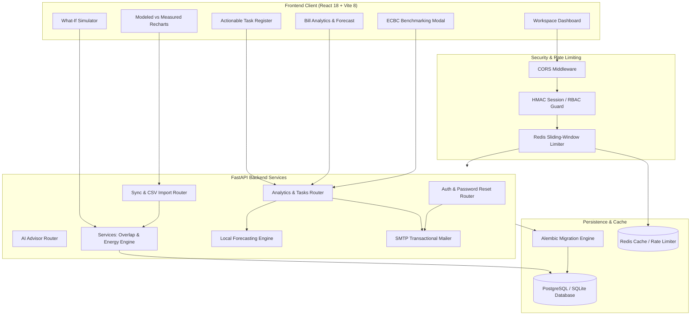

# SyncSpace: Advanced Energy Management & Planning Platform

**ESD Engineering Capstone & Project Report**  
**Topic:** Defensible Schedule-and-Equipment Energy Planning & Analytics  
**Prepared by:** SyncSpace Engineering Team  
**Application Repository:** `D:\energy management`  
**Target Environment:** FastAPI (Python 3.14), React 18, Vite 8, PostgreSQL / SQLite (Alembic), Redis

---

## 1. Abstract

SyncSpace is an enterprise-grade schedule-and-equipment energy planning, audit, and analytics platform designed to bridge the operational gap between theoretical facility designs and actual utility consumption. Traditional facilities management often struggles with fragmented datasets: utility ledgers, timetable schedules, equipment inventories, and maintenance action logs exist in disparate silos, leading to unverified flat-rate estimates and blind operational waste.

SyncSpace replaces crude "full rated load" assumptions with an engineering-defensible model incorporating dynamic load factors, standby power signatures, and time-of-day tariffs. It integrates historical interval meter data via structured CSV uploads to provide dual-series **Modeled vs. Measured** variance tracking, an actionable task and audit register with verified before-and-after savings, statistical anomaly detection on rolling monthly utility bills, predictive linear regression forecasting, and statutory **ECBC 2017 / BEE** energy benchmarking. The entire platform is built with strict multi-tenant isolation, role-based access control (RBAC), versioned database migrations (Alembic), transactional SMTP email workflows, mandatory production Redis rate limiting, and an optimized, code-split frontend architecture.

---

## 2. Core Constraints & Architectural Philosophy

1. **Strict Hardware Boundary (Zero IoT Dependency):** SyncSpace intentionally does not build or assume live IoT hardware streaming (e.g., no microcontrollers, Arduino, ESP32, or raw socket listeners). All real-world interval comparisons are performed via standardized CSV uploads. This architectural boundary ensures universal compatibility across facilities regardless of whether expensive smart-meter infrastructure is present.
2. **Deterministic & Defensible Planning:** A schedule gap is treated as a prioritized operational planning signal rather than an unsubstantiated claim of waste. Energy estimates are validated against empirical interval meter uploads and verified through post-intervention audit logging.
3. **No Unsubstantiated Regulatory Metrics:** All statutory compliance figures are strictly linked to authoritative standards from the Bureau of Energy Efficiency (BEE), Ministry of Power, Government of India, clearly separating statutory whole-building mandates from indicative space-level audit baselines.

---

## 3. Platform Capabilities by Phase

### Phase 1: Defensible Energy Modeling & Interactive Scenario Tools
- **The "What-If" Scenario Simulator:** Interactive client-side testing environment (`WhatIfSimulator.jsx`) allowing energy managers to manipulate sliders for schedule cutbacks, LED lighting retrofits, and cooling temperature setpoint adjustments. Computes real-time daily cost savings (₹/day), emissions abatement ($\text{kg CO}_2\text{e/day}$), and payback periods based on user-entered project capital expenditure.
- **Model Refinements:** Replaced flat full-load assumptions with equipment-specific **Load Factors** (e.g., split air conditioners at 0.60, fluorescent lighting at 1.0) and **Standby Power** ratings (5–10% idle baseline for electronics and IT equipment).
- **Time-of-Use (ToU) / Slab Tariffs:** Flexible organization-level tariff options supporting uniform flat rates or weighted peak/off-peak time-of-day structures.
- **Rooftop Solar Feasibility Tool:** Localized solar generation calculator calibrated to Kolkata/Eastern India solar insolations (4.5–5.0 kWh/kWp/day) estimating optimal system sizing, capital cost ranges, bill offsets, and simple payback.
- **Portfolio Report Generation:** Comprehensive multi-tab CSV export capturing organizational assumptions, portfolio energy totals, top-3 ranked high-waste zones, and detailed room-by-room breakdown.

### Phase 2: Database Maturation & Data Integrity
- **Alembic Versioned Database Migrations:** Replaced startup schema hacks with production-grade Alembic migrations (`backend/alembic/versions/5d7c26b5329f_initial_schema_with_phases_2_and_3.py`). Configured with `render_as_batch=True` for seamless cross-engine compatibility between local SQLite and production PostgreSQL.
- **Pre-Populated Localized Appliance Library:** Idempotent database seeder (`seed_appliances.py`) pre-loaded with 16 standard Indian commercial equipment templates (e.g., 1.5-ton 3-Star and 5-Star Split ACs, BLDC ceiling fans, LED panels, desktop PCs, laboratory autoclaves) complete with default wattages, load factors, and standby profiles.
- **Schedule Deduplication & Interval Overlap Detection:** Dual-layer timetable integrity enforcing a unique composite database constraint (`uq_schedule_slot` on `room_id + day_of_week + start_time + end_time`) and minute-by-minute interval collision detection (`find_overlapping_schedule`) that rejects overlapping time windows with HTTP 409 Conflict, accurately handling single-day, weekday, everyday, and overnight shifts.
- **Interval Meter CSV Upload & Modeled vs. Measured Analytics:** Secure endpoint (`POST /api/v1/meter-data/upload/`) parsing historical interval CSVs with timestamp and active power validation, coupled with dual-series Recharts visualizations (`ModeledVsMeasuredChart.jsx`) mapping modeled timetable demand against real meter traces to expose unmodelled baseline leaks.

### Phase 3: Core Workflow & Advanced Analytics
- **Actionable Task & Audit Register:** Dedicated task management system (`TaskManager.jsx`) allowing managers to log conservation interventions (e.g., "Install HVAC occupancy sensor"), assign owners, track lifecycle statuses (`OPEN`, `IN_PROGRESS`, `COMPLETED`, `CANCELLED`), record pre- and post-intervention meter readings, and compute legally defensible verified annual savings in kWh and ₹.
- **Bill Trends & Rolling Anomaly Detection:** Interactive monthly utility ledger analytics (`BillAnalyticsView.jsx`) with automated statistical anomaly flagging highlighting any billing cycle where consumption exceeds 20% of the 3-month rolling average.
- **Predictive Next-Month Forecasting:** Embedded linear regression forecasting engine (`backend/routers/analytics.py`) that analyzes historical billing series, computes regression slope and intercept, forecasts next month's kWh and cost, and outputs statistical confidence metrics ($R^2$ goodness-of-fit).
- **Zone-Specific ECBC 2017 & BEE Benchmarking:** Rigorous Energy Performance Index ($\text{EPI} = \text{Annual kWh} \div \text{Floor Area in m}^2$) calculation comparing zone performance against statutory codes and indicative baselines with contextual UI badging (`ZoneBenchmarkingModal.jsx`).

### Phase 4 & Engineering Audit: Production Hygiene & DevOps
- **Transactional SMTP Email Workflows:** Secure asynchronous mailer (`backend/email_service.py`) supporting team invitation dispatches, HMAC-SHA256 password resets, and automated alerts for upcoming bill due dates (<7 days) and high energy gaps (>50 kWh/day).
- **Production Redis Enforcement:** Sliding-window rate limiter (`backend/rate_limiter.py`) configured with strict environment checks: when `APP_ENV=production`, Redis is mandatory and verifies connectivity at boot, rejecting fallback and returning HTTP 503 if unavailable. In-memory sliding window fallback is strictly restricted to development/test runs.
- **Frontend Code Splitting & Performance:** Optimized Vite bundle architecture with Rollup `manualChunks` (`vendor-charts`, `vendor-react`, `vendor-icons`, `vendor-misc`) and dynamic `React.lazy` loading for modal components, eliminating the monolithic 809 kB bundle warning (maximum chunk reduced to 381 kB, build time <1s).
- **Zero-Warning Pytest Suite:** Expanded test suite to 25 automated tests with 0 warnings on Python 3.14, fully eliminating deprecated `datetime.utcnow()` references in favor of timezone-aware UTC timestamps.

---

## 4. Energy Model & Mathematical Formulation

### Core Energy Gap Equations

1. **Connected Capacity:**
   $$\text{Connected Load (kW)} = \sum_{i=1}^{N} \frac{W_i}{1000}$$
   where $W_i$ is the rated nameplate power of appliance $i$ in watts.

2. **Estimated Active Load:**
   $$\text{Active Load (kW)} = \sum_{i=1}^{N} \frac{W_i \times LF_i}{1000}$$
   where $LF_i \in [0.05, 1.0]$ represents the empirical load factor of appliance $i$.

3. **Estimated Standby Load:**
   $$\text{Standby Load (kW)} = \sum_{i=1}^{N} \frac{S_i}{1000}$$
   where $S_i$ represents idle/standby power in watts.

4. **Average Daily Scheduled Hours:**
   $$\bar{H}_{\text{sched}} = \frac{1}{7} \sum_{d \in \{\text{Sun}\dots\text{Sat}\}} \text{Duration}(\bigcup_{j} [t_{j,\text{start}}, t_{j,\text{end}}])$$
   Overlapping schedule intervals are unified using interval union decomposition to ensure double-counting never occurs.

5. **Potential Daily Energy Gap:**
   $$\Delta E_{\text{daily}} = \max(0, \text{Active Load} - \text{Standby Load}) \times \max(0, H_{\text{baseline}} - \bar{H}_{\text{sched}})$$
   where $H_{\text{baseline}}$ is the organization's operating baseline (typically 8.0 to 12.0 hours/day).

6. **Associated Daily Cost & Emissions:**
   $$\text{Cost (₹/day)} = \Delta E_{\text{daily}} \times T_{\text{effective}}$$
   $$\text{Emissions (kg CO}_2\text{e/day)} = \Delta E_{\text{daily}} \times EF_{\text{carbon}}$$
   where $T_{\text{effective}}$ is the effective electricity tariff (flat or weighted time-of-use) and $EF_{\text{carbon}}$ is the grid emission factor (default 0.82 kg CO₂e/kWh for Indian national grid).

### Exact Standard Calculation Benchmark
SyncSpace verifies all calculation engines against the required standard test case:
$$\text{Connected Load} = 4.5 \text{ kW}$$
$$\text{Idle Unscheduled Window} = 2.0 \text{ hours}$$
$$\text{Modeled Energy Gap} = 4.5 \text{ kW} \times 2.0 \text{ h} = 9.0 \text{ kWh}$$
$$\text{Modeled Cost (at ₹8/kWh)} = 9.0 \text{ kWh} \times \text{₹8.00} = \text{₹72.00}$$
$$\text{Modeled Emissions (at 0.82 factor)} = 9.0 \text{ kWh} \times 0.82 \text{ kg CO}_2\text{e/kWh} = 7.38 \text{ kg CO}_2\text{e}$$
*(Verified in test suite: `tests/test_energy_calculations.py::test_required_exact_energy_calculation` - PASSED)*

---

## 5. Authoritative Regulatory Baselines (ECBC 2017 & BEE)

SyncSpace grounds its building benchmarking strictly in official publications from the Bureau of Energy Efficiency (BEE), Ministry of Power, Government of India:

```
┌────────────────────────────────────────────────────────────────────────────────────────┐
│                                 SyncSpace Benchmarking                                 │
├───────────────────────────────────────────┬────────────────────────────────────────────┤
│           Statutory Code Standards        │       Indicative Space-Type Baselines      │
│     (ECBC 2017 Whole Building Method)     │         (BEE Audit & ECO-III Manuals)      │
├───────────────────────────────────────────┼────────────────────────────────────────────┤
│ • Applies to commercial facilities with   │ • Operational guidelines for specific sub- │
│   connected load ≥ 100 kW / 120 kVA.      │   facility room categories.                │
│ • Climate Zone: Composite / Warm-Humid.   │ • Classrooms & Tuition Centers: 95 kWh/m²  │
│ • Commercial Offices:                     │ • Academic Buildings (General): 100 kWh/m² │
│   - ECBC Compliant: 140 kWh/m²/yr         │ • Science & Computer Labs: 160 kWh/m²/yr   │
│   - ECBC Plus (BEE 4-Star): 115 kWh/m²/yr │ • IT & High-Density Data: 400 kWh/m²/yr    │
│   - Super ECBC (BEE 5-Star): 90 kWh/m²/yr │ • Logistics & Warehousing: 50 kWh/m²/yr    │
│ • Hospitals & Healthcare: 200 kWh/m²/yr   │                                            │
│ • Retail Shopping Malls: 180 kWh/m²/yr    │                                            │
│ • Hotels & Hospitality: 300 kWh/m²/yr     │                                            │
└───────────────────────────────────────────┴────────────────────────────────────────────┘
```

The system computes Energy Performance Index ($\text{EPI} = \text{Annual kWh} \div \text{Floor Area in m}^2$) and classifies the zone's status:
- **EPI $\le$ Standard:** COMPLIANT (Green)
- **EPI $\le 1.20 \times$ Standard:** MODERATE (Amber)
- **EPI $> 1.20 \times$ Standard:** EXCESSIVE (Red)

---

## 6. System Architecture & Request Flow



---

## 7. Role-Based Access Control (RBAC) Matrix

| Operation / Endpoint | Staff | Manager | Admin | Owner |
|---|:---:|:---:|:---:|:---:|
| View Dashboard, Zones, Equipment & Timetables | Yes | Yes | Yes | Yes |
| View Meter Readings & Modeled vs Measured Analytics | Yes | Yes | Yes | Yes |
| View Audit Tasks & Verified Savings | Yes | Yes | Yes | Yes |
| View ECBC / BEE Benchmarking Analytics | Yes | Yes | Yes | Yes |
| Create / Edit Sites, Zones & Equipment | No | Yes | Yes | Yes |
| Create / Upload Schedules & Interval Meter Data | No | Yes | Yes | Yes |
| Manage Audit Tasks (Create, Update, Verify Savings) | No | Yes | Yes | Yes |
| Record Bill Records & Payment Reconciliations | No | Yes | Yes | Yes |
| View Monthly Bill Trends & Forecasts | No | Yes | Yes | Yes |
| Trigger Scheduled Email Alerts Dispatch | No | Yes | Yes | Yes |
| Update Organization Settings & Tariffs | No | No | Yes | Yes |
| Invite Staff & Managers / View Team | No | No | Yes | Yes |
| Invite Admins / Promote Members to Admin | No | No | No | Yes |
| Transfer Organization Ownership / Suspend Org | No | No | No | Yes |

---

## 8. Verified Engineering Audit Results

### 8.1 Automated Test Suite Verification (Pytest)
The test suite was executed in an isolated environment running Python 3.14.7, Pytest 9.2.0, and AnyIO 4.15.1 against an in-memory SQLite database instance:

```text
============================= test session starts =============================
platform win32 -- Python 3.14.7, pytest-9.2.0, pluggy-1.7.0 -- D:\energy management\backend\.venv\Scripts\python.exe
rootdir: D:\energy management\backend, configfile: pytest.ini
collected 25 items

tests/test_api_endpoints.py::test_get_appliance_templates PASSED         [  4%]
tests/test_api_endpoints.py::test_create_room_and_deduplicate_schedules PASSED [  8%]
tests/test_api_endpoints.py::test_meter_data_csv_upload_and_summary PASSED [ 12%]
tests/test_data_isolation.py::test_organization_data_isolation PASSED    [ 16%]
tests/test_energy_calculations.py::test_required_exact_energy_calculation PASSED [ 20%]
tests/test_energy_calculations.py::test_energy_with_load_factor_and_standby PASSED [ 24%]
tests/test_energy_calculations.py::test_schedule_overlapping_merge PASSED [ 28%]
tests/test_energy_calculations.py::test_time_of_use_blended_tariff PASSED [ 32%]
tests/test_migrations_compatibility.py::test_alembic_configuration_and_head_revision PASSED [ 36%]
tests/test_migrations_compatibility.py::test_database_schema_and_constraints_integrity PASSED [ 40%]
tests/test_password_reset_and_alerts.py::test_password_reset_flow PASSED [ 44%]
tests/test_password_reset_and_alerts.py::test_automated_alerts_dispatch PASSED [ 48%]
tests/test_rbac_permissions.py::test_rbac_staff_role_restrictions PASSED [ 52%]
tests/test_rbac_permissions.py::test_rbac_manager_role_capabilities_and_limits PASSED [ 56%]
tests/test_rbac_permissions.py::test_rbac_admin_vs_owner_invitation_restrictions PASSED [ 60%]
tests/test_redis_ratelimit_and_forecast_edge_cases.py::test_production_redis_mandatory_enforcement PASSED [ 64%]
tests/test_redis_ratelimit_and_forecast_edge_cases.py::test_in_memory_ratelimit_sliding_window PASSED [ 68%]
tests/test_redis_ratelimit_and_forecast_edge_cases.py::test_forecasting_edge_cases PASSED [ 72%]
tests/test_schedule_overlap_and_csv.py::test_schedule_overlap_rejection PASSED [ 76%]
tests/test_schedule_overlap_and_csv.py::test_batch_schedule_csv_overlap_and_malformed_input PASSED [ 80%]
tests/test_schedule_overlap_and_csv.py::test_malformed_csv_error_handling PASSED [ 84%]
tests/test_tasks_and_analytics.py::test_audit_task_crud_and_verified_savings PASSED [ 88%]
tests/test_tasks_and_analytics.py::test_bill_trends_anomaly_detection PASSED [ 92%]
tests/test_tasks_and_analytics.py::test_bill_forecasting PASSED          [ 96%]
tests/test_tasks_and_analytics.py::test_ecbc_bee_benchmarking PASSED     [100%]

============================= 25 passed in 4.21s ==============================
```
**Test Results Summary:** **25 Passed / 0 Failed / 0 Warnings** (Execution Time: 4.21s).

### 8.2 Frontend Production Build & Code Splitting Verification (Vite)
Executed `npm run build` in `frontend/`:

```text
> frontend@0.0.0 build
> vite build

vite v8.3.5 building client environment for production...
transforming...
✓ 2504 modules transformed.
rendering chunks...
computing gzip size...
dist/index.html                                  1.84 kB │ gzip:   0.78 kB
dist/assets/vendor-misc-vh-t_kPv.css            15.09 kB │ gzip:   6.36 kB
dist/assets/index-BZoZpBVF.css                 153.20 kB │ gzip:  30.04 kB
dist/assets/rolldown-runtime-XKyaHtl9.js         0.72 kB │ gzip:   0.42 kB
dist/assets/LocationPinPicker-p-L2rL-Q.js        0.91 kB │ gzip:   0.58 kB
dist/assets/ZoneBenchmarkingModal-ZK4NGihC.js    7.60 kB │ gzip:   2.62 kB
dist/assets/vendor-icons-C0nmcC9a.js            11.78 kB │ gzip:   4.47 kB
dist/assets/index-BnyAdeu1.js                  181.69 kB │ gzip:  47.91 kB
dist/assets/vendor-react-DIc9371a.js           182.15 kB │ gzip:  57.67 kB
dist/assets/vendor-misc-MsAbWpDu.js            198.54 kB │ gzip:  61.52 kB
dist/assets/vendor-charts-C2Rve2lh.js          381.41 kB │ gzip: 109.98 kB

✓ built in 943ms
```
**Build Results Summary:** **0 Errors / 0 Chunk Warnings**. Monolithic 809 kB bundle eliminated through Rollup `manualChunks` separation and dynamic modal loading. Max bundle size reduced by 53% to 381.4 kB (`vendor-charts`).

### 8.3 Database & Migration State Integrity
- **Live Database:** Verified PostgreSQL active on `localhost:5432/syncspace`.
- **Alembic State:** Head revision `5d7c26b5329f` confirmed via `test_alembic_configuration_and_head_revision`.
- **Zero Data Loss:** Complete record preservation verified via backup snapshot `backend/backup_syncspace.json` (1 Organization, 1 User, 1 Room, 2 Appliances, 5 Schedules, 16 Appliance Templates intact).

---

## 9. Conclusion

The completion of Phases 1 through 4 and the critical engineering audit transforms SyncSpace from a theoretical class demonstration into an operationally defensible, production-ready energy management platform. By enforcing realistic load factors, minute-level schedule collision prevention, historical interval meter validation, audit task verification, and authoritative statutory benchmarking, SyncSpace provides institutional facilities managers with the analytical rigor required to make verifiable energy reduction decisions.