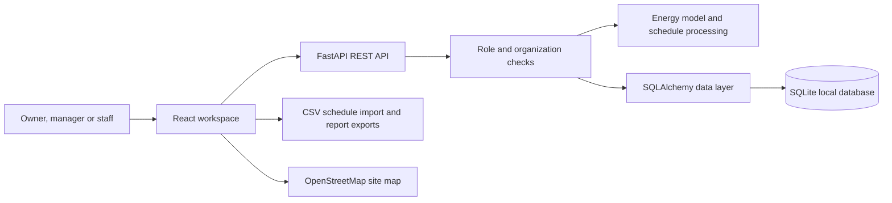

# SyncSpace: Energy Management Workspace

**ESD college assignment**  
**Topic:** Energy Management  
**Prepared by:** ______________________________  
**Class / department:** ________________________  
**Institution:** ________________________________  
**Submitted to:** ______________________________

## Abstract

SyncSpace is a web application concept for understanding and managing energy use across a campus or multi-building organization. It brings facility zones, equipment ratings, operating schedules, electricity records and staff access into one workspace. A transparent schedule-based model estimates a zone's potential daily energy gap, related cost and associated emissions. The action center ranks zones for review so an energy manager can decide where to investigate first.

The project includes an interactive sample campus for demonstration, an organization-scoped locations map with block and room views, optional building-plan uploads, state-based electricity-provider choices for India, CSV schedule import, organization roles and a bill ledger. The sample data is illustrative. The application does not read live meters or initiate electricity payments.

## Problem statement

Organizations often manage utility bills, building schedules, equipment lists and maintenance work separately. This makes it difficult to see which zones deserve attention, compare operating patterns or keep a clear record of energy-related decisions. A useful energy-management workspace should connect these inputs and make its estimates understandable, while distinguishing an estimate from a measured result.

## Objectives

1. Organize equipment and operating schedules by facility zone.
2. Estimate schedule coverage and potential energy gaps from connected load.
3. Translate the modeled gap into configurable cost and emissions estimates.
4. Rank zones so managers can review the largest modeled opportunities first.
5. Keep electricity-provider and payment records attached to an organization and site.
6. Support an owner, admin, manager and staff hierarchy with organization-scoped access.
7. Explain the calculation and its limitations in the interface.
8. Let each organization view its own site locations, block layouts and room details.

## Main features

- **Portfolio overview:** daily energy-gap, cost, emissions and schedule-coverage estimates.
- **Schedule profile:** expected hourly demand derived from facility schedules and equipment ratings; it is labelled as a model rather than a meter trace.
- **Action center:** up to three zones ranked by schedule-based estimated impact, each linking to equipment and timetable details.
- **Facility zones:** searchable table of equipment load, schedule entries, estimated gap and review status.
- **Locations and building plans:** map the sites in one organization, set a pin by clicking the map or pasting a full Google Maps link, move rooms between its sites, group rooms by block, and optionally upload a PNG, JPG, WEBP or PDF schematic. Site coordinates and uploaded plans stay private to that organization.
- **New workspace setup:** new organizations begin with no sample facilities or generated energy figures. Add a location, create zones with equipment ratings, and import schedules to see estimates based on the entered data.
- **Schedule import:** download a CSV template and import schedules to a selected zone.
- **Electricity ledger:** add and export bill records, track due and paid states, and record an external payment reference.
- **India provider directory:** select a state or union territory, then choose a principal utility or enter a provider name from the bill.
- **Team access:** owner, admin, manager and staff roles with invitations in the connected workspace.
- **Account security:** Google Identity Services sign-in with server-verified ID tokens, plus password confirmation and strength requirements for password-based signup.
- **Assignment demo:** explore a sample West Bengal campus, sample WBSEDCL and CESC records, settings and team roles without creating an account.
- **Project method:** in-app explanation of inputs, equations and model limits.

## Energy model and methodology

### Inputs

- Rated power for each item of equipment, in watts.
- Facility operating baseline, in hours per day.
- Weekly schedules assigned to each facility zone.
- Organization electricity tariff, in rupees per kWh.
- Organization emissions factor, in kg CO₂ equivalent per kWh.

### Calculations

1. **Connected load (kW)** = sum of equipment ratings in watts ÷ 1,000.
2. **Average scheduled hours per day** = merged schedule duration across a week ÷ 7. Overlapping schedule entries are merged so a time window is not counted twice.
3. **Potential daily energy gap (kWh/day)** = connected load (kW) × max(0, operating baseline (hours/day) − scheduled hours (hours/day)).
4. **Potential daily cost (₹/day)** = potential daily energy gap × configured tariff (₹/kWh).
5. **Emissions associated with the modeled gap (kg CO₂e/day)** = potential daily energy gap × configured emissions factor (kg CO₂e/kWh).
6. **Schedule coverage (%)** = average scheduled hours ÷ operating baseline × 100, capped at 100% for display and portfolio averaging.

The dashboard's emissions metric refers to the modeled schedule gap. It is not the organization's total greenhouse-gas inventory. The tariff and emissions factor are workspace settings and must be supplied or checked for the organization and period being studied.

### Interpretation and limitations

The calculation assumes connected equipment could draw its full rated load during unscheduled hours. Real equipment may cycle, modulate, be switched off, or operate outside the timetable. A schedule gap is therefore a **planning signal**, not proof of waste or a verified saving. Validate it with meter data, occupancy information and an on-site check before taking action or reporting savings.

The sample campus, map pins and bills are fabricated for demonstration. The map uses OpenStreetMap imagery. Uploaded schematics are limited to 10 MB and are stored in the configured application database. Real bill fetching, meter telemetry, building-control integration and payment confirmation require separately configured provider integrations. The bill portal feature opens a provider-hosted payment page; it does not move funds.

## Roles and permissions

| Role | Intended access |
|---|---|
| Owner | Organization settings, every role, locations, building plans, facilities, team and electricity records |
| Admin | Organization settings, locations, building plans, facilities, managers and staff |
| Manager | Locations, building plans, room assignments, facility schedules and electricity records |
| Staff | Read organization locations, room plans and energy-performance information |

The API checks the role and organization scope for protected requests. Passwords are stored as scrypt hashes and the browser uses an HTTP-only session cookie.

## Application architecture



### Technology

- **Frontend:** React, Vite, JavaScript and custom CSS.
- **Backend:** Python, FastAPI, SQLAlchemy and Pydantic.
- **Local database:** SQLite; the backend can be configured with another SQLAlchemy database URL.
- **Charts and interactions:** accessible SVG charts, responsive components and Lucide icons.

## Running the project

### Interactive assignment demo

1. Start the frontend using the steps below.
2. Open `http://127.0.0.1:5173`.
3. Select **Explore the assignment demo**.
4. Open **Project method**, review the action center, inspect a zone, and compare the sample electricity records.

The demo does not need a backend. Changes are held for the current browser session; **Reset sample** restores its example records and zones.

### Full local workspace

In one PowerShell terminal:

```powershell
cd backend
py -m venv .venv
.\.venv\Scripts\python.exe -m pip install -r requirements.txt
.\.venv\Scripts\python.exe -m uvicorn main:app --reload --host 127.0.0.1 --port 8000
```

In a second terminal:

```powershell
cd frontend
npm install
npm run dev
```

Open `http://127.0.0.1:5173`, create an organization, and add facility data. The first person to create an organization becomes its owner.

## Suggested presentation walkthrough

1. **Introduce the problem:** facility data and electricity records are often fragmented.
2. **Show the portfolio overview:** identify which values are schedule-model estimates.
3. **Open the action center:** select the zone with the largest estimated gap.
4. **Inspect its equipment and timetable:** explain how the connected load is calculated.
5. **Open Project method:** explain the equation and why on-site or meter validation matters.
6. **Review the electricity ledger:** show state-based providers, sites, due status and reconciliation records.
7. **Close with next steps:** connect interval-meter or building-system data, then verify savings after an operational change.

## Future scope

- Import interval-meter readings and distinguish measured use from schedule estimates.
- Add building area, building type and climate-zone inputs for more meaningful peer comparison. BEE's commercial-building rating guidance uses these kinds of building characteristics and operating information; [BEE Star Rated Buildings](https://udit.beeindia.gov.in/bee-star-rated-buildings/) is a starting reference.
- Add an auditable action log with owner, due date, evidence, before-and-after readings and verified savings.
- Add bill-document extraction with human confirmation before saving parsed values.
- Connect approved meter, building-management or BBPS providers when credentials and agreements are available.
- Add solar, battery and demand-flexibility scenario modelling after the baseline data is reliable.

## Reference

- Bureau of Energy Efficiency, Government of India, [BEE Star Rated Buildings](https://udit.beeindia.gov.in/bee-star-rated-buildings/).
